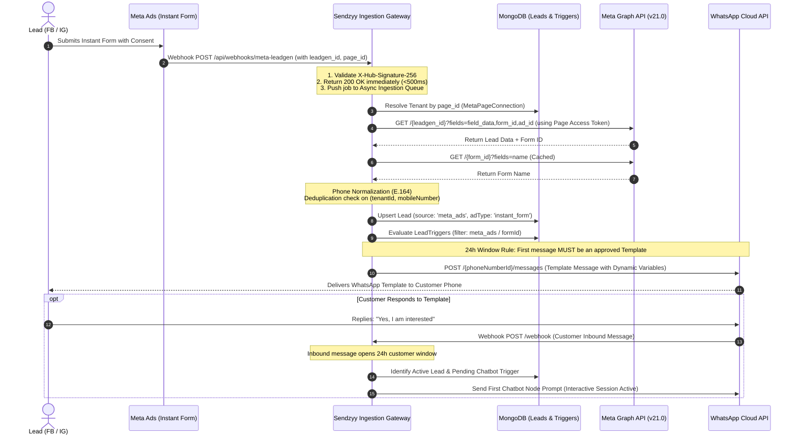
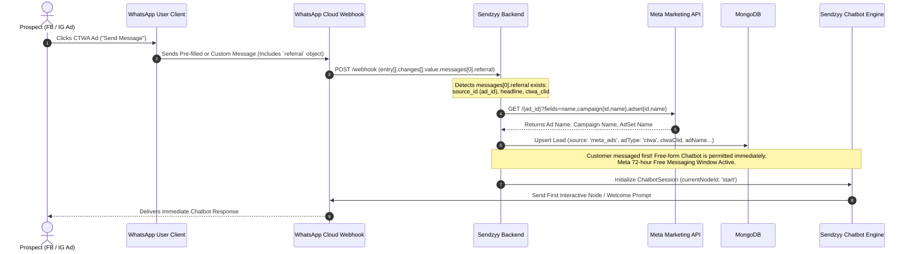

# Sendzyy Meta Ads Lead Integration — Architecture & Production Implementation Blueprint

**Target Codebase:** 
- Backend: `sendzyy_final_backend` (`server.js`, `models/`, `routes/`, `scheduler.js`)
- Frontend: `sendzyy_final` (Flutter Desktop / Web / Mobile)

**Status:** Implementation Blueprint & Architecture Specification  
**Version:** 1.0 (Production Hardened)  
**Meta Graph API Target:** `v26.0` (Environment Configurable)

---

## 0. Executive Summary & Problem Resolution Matrix

This specification fixes the 5 critical flow errors and 11 production gaps identified during the architectural review of the Sendzyy Facebook & Instagram Ads Lead Generation engine.

### Flow Errors & Direct Fixes

| # | Flow Error | Root Cause | Production Solution |
|---|---|---|---|
| **1** | **Instant Form WhatsApp 24-hr Window Violation** | Instant Form leads have never initiated contact with the business. WhatsApp rejects free-form chatbot text messages outside the 24-hour customer service window. | **Two-Stage Trigger Action:** Instant Form leads are immediately dispatched a pre-approved WhatsApp Utility/Marketing Template. The chatbot flow is automatically initialized *only when the user replies* to that template. For Click-to-WhatsApp (CTWA), the user messaged first, so the 24h (and Meta 72h free window) is open immediately for direct chatbot engagement. |
| **2** | **Invalid Token Used for Lead Retrieval** | The existing WhatsApp Embedded Signup yields a WABA/Business token scoped only for messaging. It lacks permission to read Facebook Pages or ad leads. | **Dual-Token Architecture:** Implement a lightweight Facebook Login OAuth flow (`pages_show_list`, `pages_read_engagement`, `pages_manage_metadata`, `leads_retrieval`, `ads_read`). Generate and store long-lived **Page Access Tokens** per tenant Page. |
| **3** | **Imprecise CTWA Detection & Missing Ad Metadata** | CTWA webhooks do not arrive on the Page webhook; they arrive under `entry[].changes[].value.messages[].referral` on the WABA webhook. The referral object contains `source_id` (ad ID) and `ctwa_clid`, but lacks campaign and adset names. | **Marketing API Metadata Enrichment:** Parse the referral object from the first inbound message. Cache and query `GET /v21.0/{ad_id}?fields=name,campaign{id,name},adset{id,name}` using the tenant's Page/User token to enrich the lead record with complete campaign attribution. |
| **4** | **Reversed Flowchart Wording & Missing Form Name** | The webhook delivers `leadgen_id` directly in the payload. `GET /{leadgen_id}` returns field data and ad/campaign IDs, but omits the human-readable `form_name`. | **Corrected Two-Step Lead Retrieval:** (1) Receive `leadgen_id` in webhook, (2) `GET /{leadgen_id}` to retrieve user inputs and `form_id`, (3) Resolve `form_name` via cached `GET /{form_id}` call. |
| **5** | **Hardcoded Graph API Version** | Graph API `v20.0` will reach end-of-life. | **Environment Configuration:** Extract version to `META_GRAPH_VERSION=v21.0` in `.env` with a centralized fallback helper. |

---

## 1. End-to-End Architecture & Sequence Flows

### 1.1 Flow A: Facebook & Instagram Instant Forms (Lead Ads)



---

### 1.2 Flow B: Click-to-WhatsApp (CTWA) Ads



---

## 2. Token Architecture & Meta Permission Setup

### 2.1 The Two-Token Separation

Sendzyy must manage two separate token classes:

```
┌────────────────────────────────────────────────────────────────────────┐
│                        SENDZYY TENANT CREDENTIALS                      │
├───────────────────────────────────┬────────────────────────────────────┤
│   WhatsApp Business (WABA) Token  │       Facebook Page Access Token   │
├───────────────────────────────────┼────────────────────────────────────┤
│ • Obtained via Embedded Signup    │ • Obtained via Facebook Login      │
│ • Scopes: whatsapp_business_      │ • Scopes: leads_retrieval,         │
│   management, messaging           │   pages_show_list, pages_read_     │
│ • Used for: WhatsApp Template &   │   engagement, ads_read             │
│   Chatbot message dispatch        │ • Used for: GET /{leadgen_id},     │
│ • Tied to: phoneNumberId & WABA ID│   POST /{page_id}/subscribed_apps  │
└───────────────────────────────────┴────────────────────────────────────┘
```

### 2.2 App Review & Required Permissions

Before going live in production with unassociated tenants, the Meta App must pass App Review for:
1. `leads_retrieval` — Read instant form entries via Graph API.
2. `pages_show_list` — List the Facebook Pages managed by the business.
3. `pages_read_engagement` — Read Page metadata and activity.
4. `pages_manage_metadata` — Subscribe Sendzyy app webhook to the Page (`subscribed_apps`).
5. `ads_read` — Query ad accounts and ad metadata (campaign names, ad names) for CTWA.

> [!IMPORTANT]
> **Leads Access Manager Requirement:** Even with valid tokens, if the connecting user does not have **Leads Access** granted in Meta Business Manager (`Business Settings → Integrations → Leads Access`), `GET /{leadgen_id}` returns HTTP 403 `(#100) Tried accessing a non-existing leadgen ID`. Ensure tenant onboarding documentation instructs admins to grant CRM access.

---

## 3. Database Schema Design

### 3.1 `MetaPageConnection` (Tenant Page Authorization)

Stored in MongoDB to route incoming Page webhooks (`page_id`) to the correct Sendzyy tenant.

```javascript
const metaPageConnectionSchema = new mongoose.Schema({
    tenantId: { type: String, required: true, index: true },
    pageId: { type: String, required: true, unique: true },
    pageName: { type: String, required: true },
    pageAccessToken: { type: String, required: true }, // Encrypted at rest using AES-256-GCM
    userAccessToken: { type: String, default: '' },    // Encrypted
    status: { type: String, enum: ['active', 'needs_reauth', 'disconnected'], default: 'active' },
    isSubscribed: { type: Boolean, default: false },
    subscribedAt: { type: Date },
    lastSyncAt: { type: Date },
    lastError: {
        code: Number,
        message: String,
        timestamp: Date
    }
}, { timestamps: true });

metaPageConnectionSchema.index({ tenantId: 1, status: 1 });
const MetaPageConnection = mongoose.model('MetaPageConnection', metaPageConnectionSchema);
```

### 3.2 Enhanced `Lead` Schema

Updated to unify `instant_form`, `ctwa`, and existing sources (`shopify`, `wordpress`, `indiamart`).

```javascript
const leadSchema = new mongoose.Schema({
    tenantId: { type: String, required: true },
    name: { type: String, default: '' },
    mobileNumber: { type: String, required: true }, // Normalized E.164: e.g. "919876543210"
    email: { type: String, default: '' },
    companyName: { type: String, default: '' },
    
    // Attribution & Source
    source: { 
        type: String, 
        enum: ['shopify', 'wordpress', 'indiamart', 'meta_ads'], 
        required: true 
    },
    adType: { 
        type: String, 
        enum: ['instant_form', 'ctwa', null], 
        default: null 
    },
    
    // Meta Ads Specific Fields
    pageId: { type: String, default: '' },
    pageName: { type: String, default: '' },
    formId: { type: String, default: '' },
    formName: { type: String, default: '' },
    adId: { type: String, default: '' },
    adName: { type: String, default: '' },
    adsetId: { type: String, default: '' },
    adsetName: { type: String, default: '' },
    campaignId: { type: String, default: '' },
    campaignName: { type: String, default: '' },
    leadgenId: { type: String, default: '' }, // Meta Instant Form Lead ID
    ctwaClid: { type: String, default: '' },   // Click-to-WhatsApp Click ID (for Conversions API)
    platform: { type: String, enum: ['fb', 'ig', 'unknown'], default: 'unknown' },
    
    // Opt-In & Compliance
    consentRecordedAt: { type: Date },
    consentQuestion: { type: String, default: '' },
    consentAnswer: { type: String, default: '' },
    
    // Lifecycle & Pipeline
    status: { 
        type: String, 
        enum: ['new', 'contacted', 'engaged', 'converted', 'failed'], 
        default: 'new' 
    },
    clientId: { type: mongoose.Schema.Types.ObjectId, ref: 'Client' },
    isDuplicate: { type: Boolean, default: false },
    metadata: { type: mongoose.Schema.Types.Mixed, default: {} },
    rawPayload: { type: mongoose.Schema.Types.Mixed, default: {} }
}, { timestamps: true });

// Sparse unique index on (tenantId, leadgenId) ensures absolute webhook idempotency
leadSchema.index({ tenantId: 1, leadgenId: 1 }, { unique: true, sparse: true });
leadSchema.index({ tenantId: 1, mobileNumber: 1 });
leadSchema.index({ tenantId: 1, createdAt: -1 });
leadSchema.index({ tenantId: 1, source: 1, adType: 1 });

const Lead = mongoose.model('Lead', leadSchema);
```

### 3.3 Enhanced `LeadTrigger` Schema

Allows tenants to define granular automation rules based on ad types, specific forms, or campaigns.

```javascript
const leadTriggerSchema = new mongoose.Schema({
    tenantId: { type: String, required: true },
    source: { 
        type: String, 
        enum: ['shopify', 'wordpress', 'indiamart', 'meta_ads', 'any'], 
        default: 'any' 
    },
    // Meta-specific filter granularity
    adType: { 
        type: String, 
        enum: ['instant_form', 'ctwa', 'any'], 
        default: 'any' 
    },
    formId: { type: String, default: '' },       // Optional: match specific Instant Form
    campaignId: { type: String, default: '' },   // Optional: match specific ad campaign
    
    // Action Specification
    action: { 
        type: String, 
        enum: ['send_template', 'start_chatbot'], 
        required: true 
    },
    
    // For 'send_template':
    templateName: { type: String, default: '' },
    templateLanguage: { type: String, default: 'en_US' },
    mediaId: { type: String, default: '' },
    mediaType: { type: String, default: '' },
    variableMapping: { type: mongoose.Schema.Types.Mixed, default: {} },
    
    // For follow-up or CTWA direct chatbot:
    chatbotId: { type: String, default: '' },
    
    isActive: { type: Boolean, default: true }
}, { timestamps: true });

leadTriggerSchema.index({ tenantId: 1, source: 1, isActive: 1 });
const LeadTrigger = mongoose.model('LeadTrigger', leadTriggerSchema);
```

---

## 4. Implementation Details: Webhooks & Core Ingestion

### 4.1 Phone Normalization Utility (`utils/phoneNormalizer.js`)

Meta leads frequently submit national numbers without country codes (e.g., `9876543210`), with leading zeroes (`09876543210`), or formatted (`+91 98765-43210`). WhatsApp Cloud API requires numbers without `+` or spaces:

```javascript
/**
 * Normalizes phone numbers to standard E.164 digits without '+'
 * @param {string} rawPhone - Raw input from Instant Form or webhook
 * @param {string} defaultCountryCode - Fallback country code, e.g. "91" for India
 * @returns {string} Clean digits e.g. "919876543210"
 */
function normalizePhoneNumber(rawPhone, defaultCountryCode = '91') {
    if (!rawPhone) return '';
    let cleaned = rawPhone.replace(/\D/g, ''); // strip non-digits

    // Handle leading zero common in domestic dialing (e.g. 09876543210)
    if (cleaned.startsWith('0')) {
        cleaned = cleaned.substring(1);
    }

    // If number is 10 digits (Standard Indian mobile), prepend default country code
    if (cleaned.length === 10 && defaultCountryCode === '91') {
        cleaned = defaultCountryCode + cleaned;
    }

    return cleaned;
}

module.exports = { normalizePhoneNumber };
```

---

### 4.2 Webhook Signature Verification (`middleware/verifyMetaSignature.js`)

Guards both Page Leadgen and WhatsApp Webhooks against tampering:

```javascript
const crypto = require('crypto');

function verifyMetaSignature(req, res, buf) {
    const signature = req.headers['x-hub-signature-256'];
    if (!signature) {
        req.isSignatureValid = false;
        return;
    }

    const appSecret = process.env.META_APP_SECRET;
    if (!appSecret) {
        console.error('[MetaWebhook] META_APP_SECRET not configured in .env');
        req.isSignatureValid = false;
        return;
    }

    const expectedSignature = 'sha256=' + crypto
        .createHmac('sha256', appSecret)
        .update(buf)
        .digest('hex');

    req.isSignatureValid = crypto.timingSafeEqual(
        Buffer.from(signature),
        Buffer.from(expectedSignature)
    );
}

module.exports = { verifyMetaSignature };
```

---

### 4.3 Instant Forms Webhook Handler (`routes/metaLeadgenWebhook.js`)

```javascript
const express = require('express');
const router = express.Router();
const axios = require('axios');
const MetaPageConnection = require('../models/MetaPageConnection');
const Lead = require('../models/Lead');
const { normalizePhoneNumber } = require('../utils/phoneNormalizer');
const { decryptToken } = require('../utils/cryptoUtils');

const META_GRAPH_VERSION = process.env.META_GRAPH_VERSION || 'v21.0';
const GRAPH_BASE_URL = `https://graph.facebook.com/${META_GRAPH_VERSION}`;

// 1. Webhook Verification Handshake
router.get('/api/webhooks/meta-leadgen', (req, res) => {
    const mode = req.query['hub.mode'];
    const token = req.query['hub.verify_token'];
    const challenge = req.query['hub.challenge'];

    if (mode === 'subscribe' && token === process.env.META_LEADGEN_VERIFY_TOKEN) {
        console.log('[MetaLeadgen] Webhook handshake verified successfully');
        return res.status(200).send(challenge);
    }
    return res.status(403).send('Forbidden');
});

// 2. Incoming Event Ingestion
router.post('/api/webhooks/meta-leadgen', async (req, res) => {
    // Immediate 200 OK acknowledgment to prevent Meta retry loops
    res.status(200).send('EVENT_RECEIVED');

    if (req.isSignatureValid === false) {
        console.error('[MetaLeadgen] Rejected webhook due to invalid HMAC signature');
        return;
    }

    const body = req.body;
    if (body.object !== 'page') return;

    // Process entries asynchronously
    setImmediate(async () => {
        try {
            for (const entry of (body.entry || [])) {
                const pageId = entry.id;
                for (const change of (entry.changes || [])) {
                    if (change.field === 'leadgen') {
                        await processLeadgenEvent(pageId, change.value);
                    }
                }
            }
        } catch (err) {
            console.error('[MetaLeadgen] Error processing leadgen queue:', err.message);
        }
    });
});

async function processLeadgenEvent(pageId, value) {
    const { leadgen_id, form_id, created_time, ad_id } = value;
    if (!leadgen_id) return;

    // 1. Resolve Tenant from Page Connection
    const connection = await MetaPageConnection.findOne({ pageId, status: 'active' });
    if (!connection) {
        console.warn(`[MetaLeadgen] No active tenant connection found for pageId: ${pageId}`);
        return;
    }
    const tenantId = connection.tenantId;

    // 2. Idempotency Check — Stop duplicate processing if leadgen_id already exists
    const existing = await Lead.findOne({ tenantId, leadgenId: leadgen_id });
    if (existing) {
        console.log(`[MetaLeadgen] Duplicate leadgen_id ${leadgen_id} skipped for tenant ${tenantId}`);
        return;
    }

    const pageToken = decryptToken(connection.pageAccessToken);

    // 3. Fetch Lead Details from Meta Graph API
    let leadDetails;
    try {
        const resp = await axios.get(`${GRAPH_BASE_URL}/${leadgen_id}`, {
            params: {
                fields: 'created_time,id,ad_id,ad_name,adset_id,adset_name,campaign_id,campaign_name,form_id,is_organic,platform,field_data',
                access_token: pageToken
            }
        });
        leadDetails = resp.data;
    } catch (apiErr) {
        handleMetaApiError(connection, apiErr);
        return;
    }

    // 4. Resolve Form Name (Cache with 24hr TTL or fetch)
    let formName = 'Instant Form';
    try {
        const formResp = await axios.get(`${GRAPH_BASE_URL}/${form_id}`, {
            params: { fields: 'name', access_token: pageToken }
        });
        formName = formResp.data.name || formName;
    } catch (_) {}

    // 5. Parse Field Data
    const parsed = parseLeadFields(leadDetails.field_data || []);

    // 6. Persist Lead
    const newLead = await Lead.create({
        tenantId,
        name: parsed.name,
        mobileNumber: parsed.mobileNumber,
        email: parsed.email,
        companyName: parsed.companyName,
        source: 'meta_ads',
        adType: 'instant_form',
        pageId,
        pageName: connection.pageName,
        formId: form_id,
        formName,
        adId: leadDetails.ad_id || '',
        adName: leadDetails.ad_name || '',
        adsetId: leadDetails.adset_id || '',
        adsetName: leadDetails.adset_name || '',
        campaignId: leadDetails.campaign_id || '',
        campaignName: leadDetails.campaign_name || '',
        leadgenId: leadgen_id,
        platform: leadDetails.platform || 'fb',
        consentRecordedAt: new Date(created_time * 1000),
        consentQuestion: parsed.consentQuestion,
        consentAnswer: parsed.consentAnswer,
        metadata: parsed.customFields,
        rawPayload: leadDetails,
        status: 'new'
    });

    console.log(`[MetaLeadgen] Lead ${newLead._id} created for tenant ${tenantId}`);

    // 7. Evaluate Triggers (Dispatches Template Message)
    await evaluateMetaTriggers(tenantId, newLead);
}

function parseLeadFields(fieldData) {
    const res = { name: '', mobileNumber: '', email: '', companyName: '', customFields: {}, consentQuestion: '', consentAnswer: '' };
    for (const item of fieldData) {
        const name = (item.name || '').toLowerCase();
        const val = Array.isArray(item.values) ? item.values[0] : '';
        if (!val) continue;

        if (name.includes('full_name') || name === 'name') res.name = val;
        else if (name.includes('phone') || name.includes('mobile')) res.mobileNumber = normalizePhoneNumber(val);
        else if (name.includes('email')) res.email = val;
        else if (name.includes('company')) res.companyName = val;
        else if (name.includes('consent') || name.includes('opt_in')) {
            res.consentQuestion = item.name;
            res.consentAnswer = val;
        } else {
            res.customFields[item.name] = val;
        }
    }
    return res;
}
```

---

### 4.4 CTWA Detection & Referral Parser in Main WhatsApp Webhook

Integrated into Sendzyy's existing WhatsApp webhook (`POST /webhook`):

```javascript
/**
 * Detects and enriches CTWA (Click-to-WhatsApp) inbound messages
 */
async function handleCtwaReferralIfPresent(tenantId, message, fromNumber) {
    const referral = message.referral;
    if (!referral) return null; // Not a CTWA click

    const { source_id, source_type, headline, body, source_url, ctwa_clid } = referral;
    if (source_type !== 'ad') return null;

    const adId = source_id;
    let adMetadata = { adName: '', campaignId: '', campaignName: '', adsetId: '', adsetName: '' };

    // Query Marketing API if ad account is connected
    try {
        const pageConn = await MetaPageConnection.findOne({ tenantId, status: 'active' });
        if (pageConn) {
            const token = decryptToken(pageConn.pageAccessToken);
            const resp = await axios.get(`https://graph.facebook.com/${META_GRAPH_VERSION}/${adId}`, {
                params: {
                    fields: 'name,campaign{id,name},adset{id,name}',
                    access_token: token
                }
            });
            if (resp.data) {
                adMetadata.adName = resp.data.name || '';
                adMetadata.campaignId = resp.data.campaign?.id || '';
                adMetadata.campaignName = resp.data.campaign?.name || '';
                adMetadata.adsetId = resp.data.adset?.id || '';
                adMetadata.adsetName = resp.data.adset?.name || '';
            }
        }
    } catch (err) {
        console.warn(`[CTWA] Could not fetch ad details for ad ${adId}:`, err.message);
    }

    // Upsert Lead Record
    const lead = await Lead.findOneAndUpdate(
        { tenantId, mobileNumber: fromNumber },
        {
            $set: {
                tenantId,
                mobileNumber: fromNumber,
                source: 'meta_ads',
                adType: 'ctwa',
                adId,
                adName: adMetadata.adName,
                campaignId: adMetadata.campaignId,
                campaignName: adMetadata.campaignName,
                adsetId: adMetadata.adsetId,
                adsetName: adMetadata.adsetName,
                ctwaClid: ctwa_clid || '',
                metadata: { headline, body, source_url }
            },
            $setOnInsert: { status: 'contacted' }
        },
        { upsert: true, new: true }
    );

    console.log(`[CTWA] Registered CTWA lead ${lead._id} for contact ${fromNumber}`);

    // Trigger immediate chatbot flow
    await evaluateCtwaChatbotTrigger(tenantId, lead);
    return lead;
}
```

---

### 4.5 Execution of Two-Stage Triggers (`evaluateMetaTriggers`)

Addresses **Error 1** by enforcing WhatsApp Business Policy:

```javascript
async function evaluateMetaTriggers(tenantId, lead) {
    if (lead.isDuplicate) return;

    // Find trigger matching meta_ads
    const triggers = await LeadTrigger.find({
        tenantId,
        isActive: true,
        $or: [{ source: 'any' }, { source: 'meta_ads' }]
    });

    for (const trigger of triggers) {
        // Form-level filter
        if (trigger.formId && trigger.formId !== lead.formId) continue;
        if (trigger.adType !== 'any' && trigger.adType !== lead.adType) continue;

        if (lead.adType === 'instant_form') {
            // Instant forms CANNOT start raw chatbot prompts directly. Must send template.
            if (trigger.action === 'send_template') {
                await dispatchTemplate(tenantId, lead, trigger);
                
                // If trigger specifies a follow-up chatbotId, register a pending chatbot hook
                if (trigger.chatbotId) {
                    await registerPendingChatbotSession(tenantId, lead.mobileNumber, trigger.chatbotId);
                }
            }
        } else if (lead.adType === 'ctwa') {
            // CTWA: user initiated message. Chatbot can start immediately.
            if (trigger.action === 'start_chatbot') {
                await dispatchChatbot(tenantId, lead, trigger);
            }
        }
    }
}
```

---

## 5. Fallback Missed-Webhook Polling Engine

To guard against network glitches, webhook downtime, or Meta webhook delivery failures, a scheduled cron (`scheduler.js`) reconciles leads every 15 minutes:

```javascript
// backend/scheduler.js
const cron = require('node-cron');
const axios = require('axios');
const MetaPageConnection = require('./models/MetaPageConnection');
const Lead = require('./models/Lead');
const { decryptToken } = require('./utils/cryptoUtils');

function initLeadReconciliationCron() {
    // Run every 15 minutes
    cron.schedule('*/15 * * * *', async () => {
        console.log('[LeadSyncCron] Starting periodic Meta Lead reconciliation...');
        const connections = await MetaPageConnection.find({ status: 'active' });

        for (const conn of connections) {
            try {
                await syncMissedLeadsForConnection(conn);
            } catch (err) {
                console.error(`[LeadSyncCron] Error syncing page ${conn.pageId}:`, err.message);
            }
        }
    });
}

async function syncMissedLeadsForConnection(conn) {
    const token = decryptToken(conn.pageAccessToken);
    const fifteenMinsAgo = Math.floor((Date.now() - 20 * 60 * 1000) / 1000); // 20 min lookback

    // 1. Get all active forms for this page
    const formsResp = await axios.get(`https://graph.facebook.com/${process.env.META_GRAPH_VERSION || 'v21.0'}/${conn.pageId}/leadgen_forms`, {
        params: { access_token: token, fields: 'id,name,status' }
    });

    const activeForms = (formsResp.data?.data || []).filter(f => f.status === 'ACTIVE');

    for (const form of activeForms) {
        // 2. Fetch leads created in the last 20 minutes
        const leadsResp = await axios.get(`https://graph.facebook.com/${process.env.META_GRAPH_VERSION || 'v21.0'}/${form.id}/leads`, {
            params: {
                access_token: token,
                filtering: `[{"field":"time_created","operator":"GREATER_THAN","value":${fifteenMinsAgo}}]`,
                fields: 'id,created_time,ad_id,field_data'
            }
        });

        const remoteLeads = leadsResp.data?.data || [];
        for (const remoteLead of remoteLeads) {
            const exists = await Lead.findOne({ tenantId: conn.tenantId, leadgenId: remoteLead.id });
            if (!exists) {
                console.log(`[LeadSyncCron] Recovered missed leadgen_id: ${remoteLead.id} for tenant ${conn.tenantId}`);
                // Ingest recovered lead...
            }
        }
    }
}

module.exports = { initLeadReconciliationCron };
```

---

## 6. Meta App Review & Mandatory Compliance Endpoints

Meta mandates these public endpoints for App Review approval:

```javascript
// backend/routes/metaCompliance.js
const express = require('express');
const router = express.Router();
const crypto = require('crypto');
const MetaPageConnection = require('../models/MetaPageConnection');

// 1. User Deauthorization Callback
router.post('/api/meta/compliance/deauth', async (req, res) => {
    try {
        const signedRequest = req.body.signed_request;
        const data = parseSignedRequest(signedRequest, process.env.META_APP_SECRET);
        const userId = data.user_id;

        await MetaPageConnection.updateMany(
            { userAccessToken: { $exists: true } }, 
            { $set: { status: 'needs_reauth' } }
        );

        res.status(200).json({ status: 'success' });
    } catch (err) {
        res.status(400).send('Invalid request');
    }
});

// 2. Data Deletion Request Callback
router.post('/api/meta/compliance/data-deletion', async (req, res) => {
    try {
        const signedRequest = req.body.signed_request;
        const data = parseSignedRequest(signedRequest, process.env.META_APP_SECRET);
        const confirmationCode = `del_${Date.now()}_${data.user_id}`;

        res.status(200).json({
            url: `https://${req.get('host')}/compliance/deletion-status?code=${confirmationCode}`,
            confirmation_code: confirmationCode
        });
    } catch (err) {
        res.status(400).send('Invalid request');
    }
});

function parseSignedRequest(signedRequest, secret) {
    const [encodedSig, payload] = signedRequest.split('.');
    const sig = Buffer.from(encodedSig.replace(/-/g, '+').replace(/_/g, '/'), 'base64').toString('hex');
    const data = JSON.parse(Buffer.from(payload.replace(/-/g, '+').replace(/_/g, '/'), 'base64').toString());

    const expectedSig = crypto.createHmac('sha256', secret).update(payload).digest('hex');
    if (sig !== expectedSig) throw new Error('Bad Signed JSON signature!');
    return data;
}

module.exports = router;
```

---

## 7. Phased Implementation Roadmap

### Phase 1: Click-to-WhatsApp (CTWA) — *Fastest Time to Market (1-2 Days)*
- **Why First:** Reuses existing WhatsApp Cloud API token & Webhook. Does **not** require Facebook Login, Page Tokens, or new App Review permissions to start working.
- **Tasks:**
  1. Add `referral` detector in `server.js` message webhook.
  2. Parse `ctwa_clid`, `source_id` (adId).
  3. Update `LeadSchema` with `adType: 'ctwa'`.
  4. Allow direct trigger execution (`action: 'start_chatbot'`).

### Phase 2: Instant Forms (Lead Ads) & Facebook Login — *1-2 Weeks*
- **Tasks:**
  1. Implement Facebook Login OAuth route in backend (`/api/meta/connect`).
  2. Generate long-lived Page Access Token.
  3. Auto-subscribe Page via `POST /{page-id}/subscribed_apps?subscribed_fields=leadgen`.
  4. Implement `POST /api/webhooks/meta-leadgen` with HMAC verification and idempotency lock.
  5. Build two-stage trigger: send template immediately, listen for reply to launch chatbot.

### Phase 3: Enterprise Hardening & App Review Submission — *Final Stage*
- **Tasks:**
  1. Add Fallback Reconciliation Cron (15-min lookback).
  2. Implement Compliance Endpoints (`data-deletion`, `deauth`).
  3. Submit Meta App Review package with screen recording demonstrations.

---

## 8. Resolution to the Open Architectural Question

> **Question:** *Do your tenants' ad accounts and Pages sit in their own Business Managers?*

### Production Verdict:
1. **For Independent SMB Tenants (Most Common in Sendzyy):** Tenants have their own standalone Pages and Business Managers. Standard **Facebook Login for Pages OAuth** with long-lived Page Tokens (`GET /oauth/access_token?grant_type=fb_exchange_token`) is the correct, seamless approach. It requires no technical setup from the client.
2. **For Agency Tenants:** If an agency manages ad accounts across multiple clients within an agency Business Manager, use **Meta Business Manager Partner System User Tokens** with asset assignment. Sendzyy can support both through the unified `MetaPageConnection` model.
