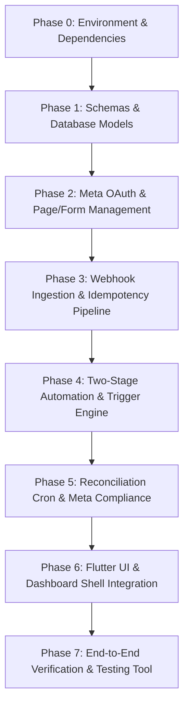

# Sendzyy Meta Ads Lead Integration — Master Preparation & Implementation Plan

**Target Repositories:** 
- Backend: `sendzyy_final_backend` (Node.js, Express, MongoDB, node-cron)
- Frontend: `sendzyy_final` (Flutter Desktop, Web, Mobile)
**Meta Graph API Target:** `v26.0` (Configurable via `META_GRAPH_VERSION`)
**Reference Blueprints:**
- [sendzyy_meta_ads_blueprint_v2.md](file:///c:/Users/admin/Desktop/sendzyy/sendzyy_final/docs/sendzyy_meta_ads_blueprint_v2.md)
- [META_ADS_LEAD_INTEGRATION_ARCHITECTURE.md](file:///c:/Users/admin/Desktop/sendzyy/sendzyy_final/docs/META_ADS_LEAD_INTEGRATION_ARCHITECTURE.md)

---

## 1. Executive Overview & Scope Boundaries

### 1.1 In-Scope vs. Out-of-Scope Ad Formats
- **IN-SCOPE:**
  1. **Instant Forms (Lead Ads):** Facebook & Instagram native forms. Ingested within seconds via Webhook $\to$ Graph API $\to$ Approved Template dispatch $\to$ Chatbot on lead reply.
  2. **Click-to-WhatsApp (CTWA):** Ads with a "Send Message" WhatsApp CTA. Ingested via WhatsApp Cloud Webhook `referral` object $\to$ Ad metadata enrichment $\to$ Immediate chatbot launch.
- **OUT-OF-SCOPE (Explicitly rejected / Not routed through this module):**
  - Traffic/Conversion ads sending users to external websites or landing pages (captured via existing Website Lead Webhooks).
  - Ads run from Facebook Pages not connected or authorized in Sendzyy.
  - Forms explicitly toggled off (`syncEnabled: false`) in tenant form settings.

---

## 2. Multi-Phase Implementation Roadmap

---

## 3. Detailed Work Breakdown Structure (WBS)

### Phase 0: Environment, Config & Dependencies
- [ ] **0.1 Backend Config Module (`backend/config/meta.js`):**
  - Centralize `META_GRAPH_VERSION` (default `v26.0`), `GRAPH_BASE_URL`, `OAUTH_SCOPES`, and `LEAD_FIELDS`.
  - Ensure zero hardcoded version strings exist in API calls.
- [ ] **0.2 Environment Variables Setup (`backend/.env`):**
  - `META_APP_ID`, `META_APP_SECRET`, `META_GRAPH_VERSION=v26.0`, `META_LEADGEN_VERIFY_TOKEN`, `META_OAUTH_REDIRECT_URI`, `META_STATE_SECRET`, `TOKEN_ENCRYPTION_KEY`, `APP_BASE_URL`.
- [ ] **0.3 Token Encryption Utility (`backend/utils/cryptoUtils.js`):**
  - AES-256-GCM authenticated encryption for Page and User access tokens.
- [ ] **0.4 Phone Normalizer Utility (`backend/utils/phoneNormalizer.js`):**
  - Normalizes international/national numbers to standard E.164 digits without `+`.
  - Flags invalid or missing numbers gracefully (`isValid: false`) instead of throwing exceptions.

---

### Phase 1: Database Schemas & Data Layer
- [ ] **1.1 `MetaConnection` Schema (`backend/models/MetaConnection.js`):**
  - Stores user-level OAuth credentials (`tenantId`, `fbUserId`, encrypted `userAccessToken`, `grantedScopes`, `declinedScopes`, `status`).
- [ ] **1.2 `MetaPageConnection` Schema (`backend/models/MetaPageConnection.js`):**
  - Stores tenant Facebook Page mappings (`tenantId`, `pageId`, `pageName`, encrypted `pageAccessToken`, `isSubscribed`, `status: active | needs_reauth | needs_attention`).
  - Compound unique constraint on `pageId` to prevent multi-tenant collisions.
- [ ] **1.3 `MetaLeadForm` Schema (`backend/models/MetaLeadForm.js`):**
  - Form registry (`tenantId`, `pageId`, `formId`, `name`, `status`, `syncEnabled`, `lastSyncedAt`).
- [ ] **1.4 `MetaLeadEvent` Idempotency Ledger (`backend/models/MetaLeadEvent.js`):**
  - Unique compound index on `{ tenantId: 1, dedupeKey: 1 }` with 90-day TTL index.
  - Replaces broken sparse unique index on `Lead` to prevent non-Meta lead collisions.
- [ ] **1.5 Enhanced `Lead` Schema (`backend/models/Lead.js` or `server.js`):**
  - Add `source: 'meta_ads'`, `touchpoints[]` array, `meta` latest snapshot, `needsAttention: Boolean`, `invalidPhoneRaw: String`.
  - Make `mobileNumber` optional with partial index: `{ tenantId: 1, mobileNumber: 1 }, { unique: true, partialFilterExpression: { mobileNumber: { $type: "string", $gt: "" } } }`.
- [ ] **1.6 Updated `LeadTrigger` Schema & Strict Validation:**
  - Support `source: 'meta_ads'`, `adType: 'instant_form' | 'ctwa'`, `formId`, `campaignId`.
  - **Strict validation:** Rejects triggers for `instant_form` with `action: 'start_chatbot'` (HTTP 400). Requires `action: 'send_template'` with approved template name and variable mapping.

---

### Phase 2: Meta OAuth & Page/Form Management
- [ ] **2.1 Connect URL Generator (`GET /api/meta/connect-url`):**
  - Generates Facebook OAuth dialog URL with signed HMAC state (`tenantId + nonce + expiry`).
- [ ] **2.2 OAuth Callback & Token Exchange (`GET /api/meta/callback`):**
  - Verifies state HMAC.
  - Exchanges short-lived code $\to$ long-lived user token $\to$ queries `/me/accounts` for non-expiring Page tokens.
  - Validates granted permissions vs required scopes.
- [ ] **2.3 Page Discovery & Webhook Subscription (`GET /api/meta/pages` & `POST /api/meta/pages/:id/subscribe`):**
  - Subscribes active pages via `POST /{page-id}/subscribed_apps?subscribed_fields=leadgen`.
- [ ] **2.4 Form Listing & Sync Settings (`GET /api/meta/forms`, `POST /api/meta/forms/:id/toggle-sync`):**
  - Syncs forms from Graph API and allows tenants to toggle sync on/off.
- [ ] **2.5 Diagnostic "Test Lead Access" Endpoint (`POST /api/meta/pages/:id/test-access`):**
  - Tests whether the connected user has "Leads Access" in Meta Business Settings and returns actionable resolution steps on code 100/200.

---

### Phase 3: Webhook Ingestion & Deduplication Pipeline
- [ ] **3.1 Raw Body Capture (`backend/middleware/verifyMetaSignature.js`):**
  - Attaches `req.rawBody` for `/api/webhooks/meta-leadgen` and `/webhook`.
  - Validates `x-hub-signature-256` timing-safe comparison.
- [ ] **3.2 Leadgen Webhook Handler (`backend/routes/metaLeadgenWebhook.js`):**
  - Handshake: `GET /api/webhooks/meta-leadgen` validates `hub.verify_token`.
  - Ingestion: `POST /api/webhooks/meta-leadgen` enqueues lead event and responds 200 OK immediately.
- [ ] **3.3 Ingestion Worker (`backend/services/metaLeadIngestion.js`):**
  - Resolves tenant by `page_id`.
  - Checks if `form_id` has `syncEnabled: false` (skips if disabled).
  - Claims idempotency ledger `MetaLeadEvent`.
  - Queries `GET /v26.0/{leadgen_id}` using Page token.
  - Queries `GET /v26.0/{form_id}` for human-readable form name (cached 24h).
  - Normalizes phone numbers (handles missing/invalid phone $\to$ `needsAttention: true`).
  - Deduplicates lead by `(tenantId, mobileNumber)`: pushes to `touchpoints[]`, updates `meta` snapshot.
- [ ] **3.4 CTWA Detection in WhatsApp Cloud Webhook (`backend/server.js`):**
  - Parses `entry[].changes[].value.messages[0].referral`.
  - Claims `ctwa:{wamid}` ledger entry.
  - Queries Marketing API `GET /v26.0/{ad_id}` with User Token (`ads_read`) for campaign/ad names.
  - Upserts lead record and initiates immediate chatbot session.

---

### Phase 4: Two-Stage Automation & Trigger Execution
- [ ] **4.1 Instant Form Template Dispatch:**
  - Evaluates matching `LeadTrigger` for `instant_form`.
  - Resolves dynamic variables (`{{1}} = first_name`, etc.) and dispatches approved template via WhatsApp Cloud API.
  - Updates lead status to `contacted`.
- [ ] **4.2 Pending Chatbot Session Registry:**
  - If trigger specifies `chatbotId`, creates `PendingChatbotSession` with 7-day TTL.
- [ ] **4.3 Inbound Customer Reply Listener:**
  - In WhatsApp webhook inbound message handler, checks if contact has an active `PendingChatbotSession`.
  - If found, marks session consumed, updates lead status to `engaged`, and triggers the first chatbot node.

---

### Phase 5: Missed-Lead Reconciliation & Meta Compliance
- [ ] **5.1 15-Minute Reconciliation Cron (`backend/scheduler.js`):**
  - Distributed lock (`cronLock`) to ensure single-runner execution across instances.
  - Polls `GET /v26.0/{form_id}/leads?filtering=time_created>lastSyncedAt` with cursor pagination.
  - Idempotently pushes missed leads to ingestion queue.
- [ ] **5.2 "Sync Now" Manual Backfill (`POST /api/meta/forms/:id/sync-now`):**
  - Allows manual on-demand backfill for a chosen form.
- [ ] **5.3 Mandatory Compliance Callbacks (`backend/routes/metaCompliance.js`):**
  - `POST /api/meta/compliance/deauth` (decodes signed request, revokes affected user's tokens).
  - `POST /api/meta/compliance/data-deletion` (creates deletion confirmation and tracking URL).
  - `GET /compliance/deletion-status` (public verification page for Meta App Review).

---

### Phase 6: Flutter Frontend Integration (`sendzyy_final`)
- [ ] **6.1 Dashboard Shell Navigation (`lib/features/dashboard/presentation/pages/dashboard_shell.dart`):**
  - Add **Meta Ads** item under `_buildExpandableLeadsMenu` (`Icons.campaign_rounded`, index 20).
  - Add `MetaAdsLeadsPage` to `_pages` list.
- [ ] **6.2 State Management & API Client (`lib/features/leads/presentation/bloc/`):**
  - BLoC/Repository for fetching Meta connection status, pages, forms, leads, and trigger settings.
- [ ] **6.3 Main Meta Ads Page (`lib/features/leads/presentation/pages/meta_ads_leads_page.dart`):**
  - **Connection Banner:** Not Connected (Connect Facebook button), Connected (Page count & token status), or Reconnect Required (`needs_reauth`).
  - **Page & Form Selector:** Accordion showing connected Pages, forms with sync toggles, and "Sync now" button.
  - **KPI Metrics:** Total Meta Leads, Leads Today, Contacted, Engaged, Converted.
  - **Filter Chips:** Instant Form vs CTWA, FB vs IG, Form, Campaign, Status, Has Phone.
  - **Leads Table:** Table with status pills, `Needs attention` badge for missing phones, and slide-over touchpoint drawer.
- [ ] **6.4 Automation Trigger Modal (`lib/features/leads/presentation/widgets/meta_trigger_dialog.dart`):**
  - Strict UI guardrail: When `Instant Form` is chosen, only allow WhatsApp Template selection with variable mappings; show clear notice explaining the 24-hour customer window.
  - When `Click-to-WhatsApp` is chosen, allow direct Chatbot selection.

---

### Phase 7: Verification & Testing Checklist
- [ ] **7.1 Meta Lead Ads Testing Tool:**
  - Generate mock Instant Form submissions for test pages and verify end-to-end ingestion in Sendzyy within 3 seconds.
- [ ] **7.2 Error Handling & Re-auth Tests:**
  - Simulate Meta Error 190 (expired token) $\to$ verify status changes to `needs_reauth`.
  - Simulate Meta Error 100 (missing Leads Access) $\to$ verify status changes to `needs_attention` with instructional banner.
- [ ] **7.3 Edge Case Tests:**
  - Duplicate webhook delivery $\to$ verified idempotency via `MetaLeadEvent`.
  - Lead submission without phone number $\to$ verified saved with `needsAttention: true`.
  - Lead submitted for form with `syncEnabled: false` $\to$ verified dropped cleanly.
  - Form submission $\to$ template sent $\to$ customer replies $\to$ chatbot launched.

---

## 4. Immediate Next Step

We will execute **Phase 0 & Phase 1** (Backend Data Layer & Configurations):
1. Create `backend/config/meta.js` and update `backend/utils/cryptoUtils.js` and `phoneNormalizer.js`.
2. Define models: `MetaConnection.js`, `MetaPageConnection.js`, `MetaLeadForm.js`, and `MetaLeadEvent.js`.
3. Add `source: 'meta_ads'` and touchpoint schema to `Lead` and trigger validations to `LeadTrigger`.
