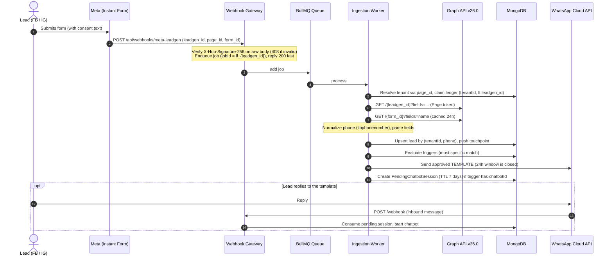
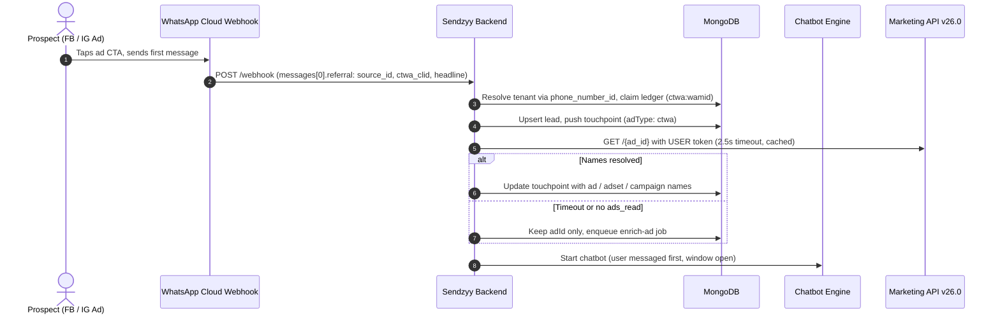

# Sendzyy Meta Ads Lead Integration: Corrected Blueprint (v2)

**Backend:** `sendzyy_final_backend` (Node.js, Express, MongoDB/Mongoose)
**Frontend:** `sendzyy_final` (Flutter Desktop / Web / Mobile)
**Meta Graph API version:** `v26.0`, configured through `META_GRAPH_VERSION` (never hardcoded)
**Replaces:** Blueprint v1.0

---

## 0. What changed from v1

### 0.1 Flow errors (fixed in v1, kept here)

| # | Issue | Fix |
|---|---|---|
| 1 | Instant Form leads have no open 24-hour window, so a chatbot prompt cannot be the first message | Two-stage trigger: send an approved template first, start the chatbot only after the lead replies. CTWA leads messaged first, so the chatbot starts immediately |
| 2 | WABA token from Embedded Signup cannot read Pages or leads | Separate Facebook Login flow, long-lived user token, then non-expiring Page tokens from `/me/accounts` |
| 3 | CTWA referral arrives on the WhatsApp webhook and has no campaign/ad names | Parse `messages[].referral`, then enrich names with the Marketing API using the **user** token (`ads_read`) |
| 4 | Flowchart wording reversed; form name missing from lead object | Webhook gives `leadgen_id`; `GET /{leadgen_id}` returns `field_data`; `GET /{form_id}` returns the form name |
| 5 | Hardcoded API version | `META_GRAPH_VERSION=v26.0` through one shared config module |

### 0.2 Bugs and gaps found in v1 (fixed in this version)

| # | v1 problem | v2 fix |
|---|---|---|
| 6 | `sparse` unique index on `(tenantId, leadgenId)` with `default: ''` made every non-Meta lead collide | No default value; idempotency moved to a separate `MetaLeadEvent` ledger with a unique `(tenantId, dedupeKey)` index |
| 7 | Deauth callback marked **all** tenants' connections `needs_reauth` | Store `fbUserId`; filter by it; revoke and wipe tokens only for that user |
| 8 | Data-deletion callback deleted nothing | Creates a deletion request, runs a purge job, serves a status page |
| 9 | Ad enrichment used a Page token | Uses the stored user token with `ads_read` |
| 10 | Phase 1 claimed no new permissions were needed | Phase 1 works without names; names need `ads_read` and a user token |
| 11 | `timingSafeEqual` threw on length mismatch; invalid signature still returned 200 | Length check, 403 on bad signature, raw body captured via `express.json({ verify })` |
| 12 | `setImmediate` used as a queue (lost on restart) | BullMQ queue with retries and exponential backoff |
| 13 | `mobileNumber` required, so leads without a phone crashed | Optional; such leads saved with `needsAttention: true` |
| 14 | Dedup promised but never implemented; `isDuplicate` never set; CTWA upsert overwrote `source` | Single lead per `(tenantId, mobileNumber)`, `firstSource` kept, `touchpoints[]` array |
| 15 | `campaignId` filter existed but was never evaluated | Specificity-based trigger matching on `adId`, `formId`, `campaignId`, `adType` |
| 16 | `evaluateCtwaChatbotTrigger` undefined; bot restarted on every referral | Defined; skipped when a session is already active |
| 17 | Pending chatbot session had no expiry | TTL index (7 days) and consume-on-reply |
| 18 | Cron had no pagination, no real ingestion, fixed 20-minute lookback, no lock | Cursor-based pagination, per-form `lastSyncedAt`, queue-based ingestion, Mongo lock |
| 19 | Phone normalizer broke on `00` prefixes and non-India numbers | `libphonenumber-js` with per-tenant default country |
| 20 | Only `full_name`/`name` parsed | Standard Meta keys (`full_name`, `first_name`, `last_name`, `phone_number`, `email`, `company_name`, ...) handled |
| 21 | `fb_exchange_token` described as returning Page tokens | Correct sequence: code → short-lived user token → long-lived user token → `/me/accounts` for Page tokens |
| 22 | `handleMetaApiError` undefined | Implemented, with codes 190, 4/17/32/613, permission errors |
| 23 | CTWA lead set to `contacted` on insert | Status model defined (section 9.4) |
| 24 | Hardcoded error text for Leads Access | Match on error codes, show generic guidance |
| 25 | Page connectable by two tenants was unhandled | Clear "already connected to another workspace" error |
| 26 | No idempotent resume if triggers failed after the lead was saved | Ledger states `processing → lead_saved → done` |

---

## 1. Configuration and versioning

### 1.1 `.env`

```bash
META_APP_ID=
META_APP_SECRET=
META_GRAPH_VERSION=v26.0
META_LEADGEN_VERIFY_TOKEN=
META_OAUTH_REDIRECT_URI=https://api.sendzyy.com/api/meta/callback
META_STATE_SECRET=            # signs the OAuth state parameter
TOKEN_ENCRYPTION_KEY=         # 32-byte key, hex or base64, for AES-256-GCM
REDIS_URL=redis://localhost:6379
APP_BASE_URL=https://api.sendzyy.com
```

### 1.2 `config/meta.js` (single source of truth)

```js
const META_GRAPH_VERSION = process.env.META_GRAPH_VERSION || 'v26.0';
const GRAPH_BASE_URL = `https://graph.facebook.com/${META_GRAPH_VERSION}`;

const OAUTH_SCOPES = [
  'public_profile',
  'pages_show_list',
  'pages_read_engagement',
  'pages_manage_metadata',
  'pages_manage_ads',     // Meta has historically required this to read lead forms; verify in current docs
  'leads_retrieval',
  'ads_read'              // CTWA ad/campaign names
  // 'business_management' // add only if Pages are owned by a Business Manager and /me/accounts omits them
];

const LEAD_FIELDS =
  'id,created_time,ad_id,ad_name,adset_id,adset_name,campaign_id,campaign_name,form_id,is_organic,platform,field_data';

module.exports = { META_GRAPH_VERSION, GRAPH_BASE_URL, OAUTH_SCOPES, LEAD_FIELDS };
```

### 1.3 Version checklist

- Replace every `v20.0` / `v21.0` string in the codebase with an import from `config/meta.js`.
- In the Meta App Dashboard, open **App Settings → Advanced** and set the default Graph API version. Calls without a version in the URL, and saved webhook subscriptions, use that setting.
- Marketing API sometimes versions differently from Graph API. Confirm the ad lookup (`GET /{ad_id}?fields=name,campaign{id,name},adset{id,name}`) behaves the same on `v26.0`.
- Re-read the changelog for `v26.0` before each release. Confirm `leadgen`, `leadgen_forms`, `/{form_id}/leads` and the ad lookup are unaffected.

---

## 2. Architecture and flows

### 2.1 Instant Forms (Facebook and Instagram Lead Ads)



### 2.2 Click-to-WhatsApp (CTWA)



---

## 3. Credentials, OAuth and permissions

### 3.1 Two separate credential sets

| | WhatsApp (WABA) | Facebook Login |
|---|---|---|
| Obtained via | Embedded Signup (existing) | New Facebook Login flow |
| Token types | WABA / business token | Long-lived **user** token, non-expiring **Page** tokens |
| Used for | Templates, chatbot messages | Leads, form discovery, Page subscription |
| User token also used for | n/a | `ads_read` ad-name lookup (Page tokens do not carry `ads_read`) |

### 3.2 OAuth sequence

1. `GET /api/meta/connect-url` builds the Facebook dialog URL with `scope=OAUTH_SCOPES` and a signed `state` (tenantId, nonce, 10-minute expiry, HMAC with `META_STATE_SECRET`).
2. User approves and Facebook redirects to `GET /api/meta/callback?code=...&state=...`.
3. Verify `state`, then exchange `code` for a short-lived user token (`/oauth/access_token`).
4. Exchange that for a **long-lived user token** (`grant_type=fb_exchange_token`).
5. `GET /me?fields=id,name` for `fbUserId`.
6. `GET /me/permissions` and store `grantedScopes` / `declinedScopes`. Warn in the UI if required scopes are missing.
7. `GET /me/accounts?fields=id,name,access_token` returns Pages with Page tokens. These do not expire when derived from a long-lived user token.
8. Store the encrypted user token and encrypted Page tokens.
9. Show a Page selector. For each selected Page: reject if `pageId` is already active for another tenant, then `POST /{page-id}/subscribed_apps` with `subscribed_fields=leadgen`, and mark `isSubscribed`.
10. List forms with `GET /{page-id}/leadgen_forms` and store them in `MetaLeadForm`.

### 3.3 Permissions and App Review

| Permission | Purpose |
|---|---|
| `leads_retrieval` | Read lead data |
| `pages_show_list` | List Pages |
| `pages_read_engagement` | Page metadata |
| `pages_manage_metadata` | Subscribe app to Page webhooks |
| `pages_manage_ads` | Historically required to read lead forms (verify) |
| `ads_read` | Ad, ad set, campaign names for CTWA |
| `business_management` | Only if Pages sit inside a Business Manager and are not returned otherwise |

- Request Advanced Access for these, complete Business Verification, and prepare a screencast per permission.
- Until approved, the integration works only for users with a role on your app. Use this for development and the Lead Ads Testing Tool.
- The connecting user needs **Leads Access** on the Page (Business Settings → Integrations → Leads Access) and a suitable Page role. A missing Leads Access shows up as a permission error on retrieval. Do not match on error text; surface generic guidance in the UI.

---

## 4. Database models

### 4.1 `MetaConnection` (one per tenant and Facebook user)

```js
const metaConnectionSchema = new mongoose.Schema({
  tenantId: { type: String, required: true, index: true },
  fbUserId: { type: String, required: true },
  fbUserName: String,
  userAccessToken: { type: String, required: true },   // AES-256-GCM encrypted
  tokenExpiresAt: Date,
  grantedScopes: [String],
  declinedScopes: [String],
  status: { type: String, enum: ['active', 'needs_reauth', 'revoked'], default: 'active' },
  lastError: { code: Number, message: String, at: Date }
}, { timestamps: true });

metaConnectionSchema.index({ tenantId: 1, fbUserId: 1 }, { unique: true });
metaConnectionSchema.index({ fbUserId: 1 });   // deauth / deletion lookups
```

### 4.2 `MetaPageConnection`

```js
const metaPageConnectionSchema = new mongoose.Schema({
  tenantId: { type: String, required: true, index: true },
  connectionId: { type: mongoose.Schema.Types.ObjectId, ref: 'MetaConnection', required: true },
  pageId: { type: String, required: true, unique: true },   // a Page belongs to one tenant at a time
  pageName: String,
  pageAccessToken: { type: String, required: true },       // encrypted
  status: { type: String, enum: ['active', 'needs_reauth', 'needs_attention', 'disconnected'], default: 'active' },
  isSubscribed: { type: Boolean, default: false },
  subscribedAt: Date,
  lastError: { code: Number, message: String, at: Date }
}, { timestamps: true });
```

### 4.3 `MetaLeadForm`

```js
const metaLeadFormSchema = new mongoose.Schema({
  tenantId: { type: String, required: true },
  pageId: { type: String, required: true },
  formId: { type: String, required: true },
  name: String,
  status: String,                    // ACTIVE / ARCHIVED ...
  questions: mongoose.Schema.Types.Mixed,
  syncEnabled: { type: Boolean, default: true },
  lastSyncedAt: Date
}, { timestamps: true });

metaLeadFormSchema.index({ tenantId: 1, formId: 1 }, { unique: true });
```

### 4.4 `MetaLeadEvent` (idempotency ledger)

One row per inbound event. This replaces the broken sparse unique index on `Lead`.

```js
const metaLeadEventSchema = new mongoose.Schema({
  tenantId: { type: String, required: true },
  dedupeKey: { type: String, required: true },       // "lf:{leadgenId}" or "ctwa:{wamid}"
  type: { type: String, enum: ['instant_form', 'ctwa'], required: true },
  status: { type: String, enum: ['processing', 'lead_saved', 'done', 'failed'], default: 'processing' },
  leadId: mongoose.Schema.Types.ObjectId,
  pageId: String,
  formId: String,
  error: String,
  rawPayload: mongoose.Schema.Types.Mixed
}, { timestamps: true });

metaLeadEventSchema.index({ tenantId: 1, dedupeKey: 1 }, { unique: true });
metaLeadEventSchema.index({ createdAt: 1 }, { expireAfterSeconds: 60 * 60 * 24 * 90 }); // keep 90 days
```

### 4.5 `Lead` (changes only)

```js
const touchpointSchema = new mongoose.Schema({
  dedupeKey: String,                                  // matches MetaLeadEvent.dedupeKey
  source: { type: String, default: 'meta_ads' },
  adType: { type: String, enum: ['instant_form', 'ctwa'] },
  sourceType: String,                                 // CTWA referral source_type: ad | post
  platform: { type: String, enum: ['fb', 'ig', 'unknown'], default: 'unknown' },
  isOrganic: Boolean,
  pageId: String, pageName: String,
  formId: String, formName: String,
  adId: String, adName: String,
  adsetId: String, adsetName: String,
  campaignId: String, campaignName: String,
  leadgenId: String,
  ctwaClid: String,
  headline: String, body: String, sourceUrl: String,
  consentQuestion: String, consentAnswer: String, consentRecordedAt: Date,
  at: { type: Date, default: Date.now }
}, { _id: false });

// Add / change on the existing leadSchema:
{
  mobileNumber: { type: String, default: '' },        // NOT required: leads without a phone are saved
  needsAttention: { type: Boolean, default: false },  // e.g. missing or invalid phone
  invalidPhoneRaw: String,
  source: { type: String, enum: ['shopify', 'wordpress', 'indiamart', 'meta_ads'], required: true }, // first source, never overwritten
  touchpoints: [touchpointSchema],
  meta: mongoose.Schema.Types.Mixed,                  // snapshot of the LATEST Meta touchpoint, for UI filters
  lastTemplateSentAt: Date,
  optedOut: { type: Boolean, default: false },
  status: { type: String, enum: ['new', 'contacted', 'engaged', 'converted', 'failed'], default: 'new' }
  // keep all existing fields (name, email, companyName, clientId, metadata ...)
}
// REMOVE: leadgenId, ctwaClid, formId ... as top-level defaults of ''; they live on touchpoints.

leadSchema.index({ tenantId: 1, mobileNumber: 1 });
leadSchema.index({ tenantId: 1, createdAt: -1 });
leadSchema.index({ tenantId: 1, 'touchpoints.source': 1, 'touchpoints.adType': 1 });
leadSchema.index({ tenantId: 1, 'meta.formId': 1 });
leadSchema.index({ tenantId: 1, 'meta.campaignId': 1 });
```

> **Uniqueness:** after you clean existing duplicates, add a unique partial index to stop races when two events for the same phone arrive together:
> `leadSchema.index({ tenantId: 1, mobileNumber: 1 }, { unique: true, partialFilterExpression: { mobileNumber: { $type: 'string', $gt: '' } } })`.
> Only do this if the business really wants exactly one lead per phone per tenant across all sources.

### 4.6 `LeadTrigger` (changes)

```js
{
  source: { type: String, enum: ['shopify', 'wordpress', 'indiamart', 'meta_ads', 'any'], default: 'any' },
  adType: { type: String, enum: ['instant_form', 'ctwa', 'any'], default: 'any' },
  formId: { type: String, default: '' },
  campaignId: { type: String, default: '' },
  adId: { type: String, default: '' },               // works for CTWA even before name enrichment
  action: { type: String, enum: ['send_template', 'start_chatbot'], required: true },
  templateName: String, templateLanguage: { type: String, default: 'en_US' },
  mediaId: String, mediaType: String,
  variableMapping: { type: mongoose.Schema.Types.Mixed, default: {} },
  chatbotId: String,                                  // follow-up bot after a template reply, or the CTWA bot
  cooldownDays: { type: Number, default: 7 },         // do not re-send a template within N days
  requireConsent: { type: Boolean, default: false },  // only send if the form captured consent
  isActive: { type: Boolean, default: true }
}
leadTriggerSchema.index({ tenantId: 1, source: 1, isActive: 1 });
```

### 4.7 Supporting models

```js
// PendingChatbotSession: Instant Form lead got a template, bot starts on reply
const pendingChatbotSchema = new mongoose.Schema({
  tenantId: { type: String, required: true },
  mobileNumber: { type: String, required: true },
  chatbotId: { type: String, required: true },
  leadId: mongoose.Schema.Types.ObjectId,
  expiresAt: { type: Date, required: true },
  consumedAt: Date
});
pendingChatbotSchema.index({ tenantId: 1, mobileNumber: 1 });
pendingChatbotSchema.index({ expiresAt: 1 }, { expireAfterSeconds: 0 });   // TTL

// MetaCache: form names and ad metadata
const metaCacheSchema = new mongoose.Schema({
  key: { type: String, unique: true },
  value: mongoose.Schema.Types.Mixed,
  expiresAt: Date
});
metaCacheSchema.index({ expiresAt: 1 }, { expireAfterSeconds: 0 });

// CronLock: single-runner guard across instances
const cronLockSchema = new mongoose.Schema({ key: { type: String, unique: true }, lockedUntil: Date });

// MetaDeletionRequest: data deletion callback tracking
const deletionSchema = new mongoose.Schema({
  confirmationCode: { type: String, unique: true },
  fbUserId: String,
  status: { type: String, enum: ['pending', 'completed'], default: 'pending' },
  completedAt: Date
}, { timestamps: true });
```

---

## 5. Core utilities

### 5.1 Token encryption (`utils/cryptoUtils.js`)

```js
const crypto = require('crypto');
const KEY = Buffer.from(process.env.TOKEN_ENCRYPTION_KEY, 'hex');   // 32 bytes

function encryptToken(plain) {
  const iv = crypto.randomBytes(12);
  const cipher = crypto.createCipheriv('aes-256-gcm', KEY, iv);
  const enc = Buffer.concat([cipher.update(plain, 'utf8'), cipher.final()]);
  return [iv, cipher.getAuthTag(), enc].map(b => b.toString('base64')).join('.');
}

function decryptToken(blob) {
  const [iv, tag, enc] = blob.split('.').map(s => Buffer.from(s, 'base64'));
  const d = crypto.createDecipheriv('aes-256-gcm', KEY, iv);
  d.setAuthTag(tag);
  return Buffer.concat([d.update(enc), d.final()]).toString('utf8');
}
module.exports = { encryptToken, decryptToken };
```

Never log tokens. Redact `access_token` from any logged URL or axios error.

### 5.2 Phone normalization (`utils/phoneNormalizer.js`)

```js
const { parsePhoneNumberFromString } = require('libphonenumber-js');

/**
 * @param {string} raw            value from the form or webhook
 * @param {string} defaultCountry ISO-2 code from tenant settings (e.g. 'IN')
 * @returns {{ valid: boolean, digits: string, e164: string, raw: string }}
 *   digits = E.164 without "+", which is what the WhatsApp Cloud API expects
 */
function normalizePhone(raw, defaultCountry = 'IN') {
  if (!raw) return { valid: false, digits: '', e164: '', raw: '' };
  let s = String(raw).trim();
  if (s.startsWith('00')) s = '+' + s.slice(2);              // international prefix
  const p = parsePhoneNumberFromString(s, defaultCountry);
  if (p && p.isValid()) {
    return { valid: true, digits: p.number.replace('+', ''), e164: p.number, raw: s };
  }
  return { valid: false, digits: '', e164: '', raw: s };      // e.g. Meta test-lead dummy values
}
module.exports = { normalizePhone };
```

CTWA `message.from` (`wa_id`) is already digits without `+`. Store it as is.

### 5.3 Graph client and error handling (`services/metaGraphClient.js`)

```js
const axios = require('axios');
const { UnrecoverableError } = require('bullmq');
const { GRAPH_BASE_URL } = require('../config/meta');
const MetaConnection = require('../models/MetaConnection');
const MetaPageConnection = require('../models/MetaPageConnection');

const RATE_LIMIT_CODES = [4, 17, 32, 613];

async function graphGet(path, params = {}, connection = null) {
  try {
    const { data } = await axios.get(`${GRAPH_BASE_URL}${path}`, { params, timeout: 10000 });
    return data;
  } catch (err) {
    await handleMetaApiError(connection, err);   // always throws
  }
}

async function handleMetaApiError(connection, err) {
  const e = err.response?.data?.error || {};
  const info = { code: e.code, message: (e.message || err.message || '').slice(0, 300), at: new Date() };

  if (e.code === 190) {                                   // token invalid / expired / revoked
    if (connection) {
      if (connection.connectionId) {                      // a MetaPageConnection
        await MetaPageConnection.updateMany({ connectionId: connection.connectionId }, { status: 'needs_reauth', lastError: info });
        await MetaConnection.updateOne({ _id: connection.connectionId }, { status: 'needs_reauth', lastError: info });
      } else {
        await MetaConnection.updateOne({ _id: connection._id }, { status: 'needs_reauth', lastError: info });
      }
      // await notifyTenant(connection.tenantId, 'meta_reauth_required');
    }
    throw new UnrecoverableError(`Meta token invalid (190)`);
  }

  if (RATE_LIMIT_CODES.includes(e.code)) throw err;        // retryable: let BullMQ back off

  if (e.code === 10 || e.code === 200 || e.code === 100) { // permission / object access problems
    if (connection?.connectionId) {
      await MetaPageConnection.updateOne({ _id: connection._id }, { status: 'needs_attention', lastError: info });
    }
    throw new UnrecoverableError(`Meta permission error (${e.code})`);
  }

  if (err.response && err.response.status >= 400 && err.response.status < 500) {
    throw new UnrecoverableError(`Meta 4xx (${err.response.status})`);
  }
  throw err;                                               // network / 5xx: retry
}

module.exports = { graphGet, handleMetaApiError };
```

---

## 6. Webhooks

### 6.1 Signature verification (`middleware/verifyMetaSignature.js`)

```js
const crypto = require('crypto');

// Use as: express.json({ verify: captureRawBody })
function captureRawBody(req, res, buf) { req.rawBody = buf; }

function verifyMetaSignature(req, res, next) {
  const header = req.get('x-hub-signature-256') || '';
  const secret = process.env.META_APP_SECRET;
  if (!header || !secret || !req.rawBody) return res.sendStatus(403);

  const expected = 'sha256=' + crypto.createHmac('sha256', secret).update(req.rawBody).digest('hex');
  const a = Buffer.from(header);
  const b = Buffer.from(expected);
  if (a.length !== b.length || !crypto.timingSafeEqual(a, b)) return res.sendStatus(403);
  next();
}
module.exports = { captureRawBody, verifyMetaSignature };
```

Wire it so the raw body is captured **before** JSON parsing for these routes:

```js
app.use('/api/webhooks/meta-leadgen', express.json({ verify: captureRawBody }));
app.use('/webhook', express.json({ verify: captureRawBody }));   // existing WhatsApp webhook uses the same app secret
```

### 6.2 Queue (`queues/metaQueue.js`)

```js
const { Queue, Worker } = require('bullmq');
const connection = { url: process.env.REDIS_URL };

const metaQueue = new Queue('meta-leads', {
  connection,
  defaultJobOptions: { attempts: 6, backoff: { type: 'exponential', delay: 30000 }, removeOnComplete: 1000, removeOnFail: 5000 }
});

// BullMQ custom jobIds must not contain ":", so use "lf_<id>" / "ctwa_<wamid>".
module.exports = { metaQueue, connection };
```

If you do not run Redis, use Agenda (MongoDB-backed) and keep the same job semantics.

### 6.3 Leadgen webhook (`routes/metaLeadgenWebhook.js`)

```js
const router = require('express').Router();
const { verifyMetaSignature } = require('../middleware/verifyMetaSignature');
const { metaQueue } = require('../queues/metaQueue');

// Verification handshake
router.get('/api/webhooks/meta-leadgen', (req, res) => {
  if (req.query['hub.mode'] === 'subscribe' && req.query['hub.verify_token'] === process.env.META_LEADGEN_VERIFY_TOKEN) {
    return res.status(200).send(req.query['hub.challenge']);
  }
  res.sendStatus(403);
});

// Events: acknowledge only after the job is safely queued
router.post('/api/webhooks/meta-leadgen', verifyMetaSignature, async (req, res) => {
  try {
    if (req.body.object !== 'page') return res.sendStatus(200);
    for (const entry of req.body.entry || []) {
      for (const change of entry.changes || []) {
        if (change.field !== 'leadgen') continue;
        const v = change.value || {};
        await metaQueue.add('instant-form',
          { pageId: String(v.page_id || entry.id), leadgenId: String(v.leadgen_id), formId: String(v.form_id || '') },
          { jobId: `lf_${v.leadgen_id}` });                      // duplicate deliveries collapse into one job
      }
    }
    res.sendStatus(200);
  } catch (err) {
    console.error('[MetaLeadgen] enqueue failed:', err.message);
    res.sendStatus(500);                                          // Meta will retry delivery
  }
});

module.exports = router;
```

### 6.4 Worker (`workers/metaWorker.js`)

```js
const { Worker } = require('bullmq');
const { connection } = require('../queues/metaQueue');
const { ingestInstantFormLead } = require('../services/metaLeadIngestion');
const { enrichCtwaAd } = require('../services/ctwaService');

new Worker('meta-leads', async job => {
  if (job.name === 'instant-form') return ingestInstantFormLead(job.data);
  if (job.name === 'enrich-ad')    return enrichCtwaAd(job.data);
}, { connection, concurrency: 5 });
```

---

## 7. Ingestion services

### 7.1 Field parsing

```js
const { normalizePhone } = require('../utils/phoneNormalizer');

function parseLeadFields(fieldData = [], defaultCountry) {
  const out = { name: '', email: '', companyName: '', phone: normalizePhone('', defaultCountry), custom: {}, consent: null };
  const get = f => (Array.isArray(f.values) ? f.values[0] : '') || '';
  let first = '', last = '';

  for (const f of fieldData) {
    const key = (f.name || '').toLowerCase();
    const val = get(f);
    if (!val) continue;

    if (key === 'full_name') out.name = val;
    else if (key === 'first_name') first = val;
    else if (key === 'last_name') last = val;
    else if (key === 'email') out.email = val;
    else if (key === 'phone_number' || key === 'phone' || key === 'whatsapp_number') out.phone = normalizePhone(val, defaultCountry);
    else if (key === 'company_name') out.companyName = val;
    else if (key.includes('consent') || key.includes('opt_in') || key.includes('opt-in')) out.consent = { question: f.name, answer: val };
    else out.custom[f.name] = val;                      // city, job_title, custom questions ...
  }
  if (!out.name) out.name = [first, last].filter(Boolean).join(' ');
  return out;
}
module.exports = { parseLeadFields };
```

### 7.2 Ledger helper and lead upsert (`services/metaLeadCore.js`)

```js
const Lead = require('../models/Lead');
const MetaLeadEvent = require('../models/MetaLeadEvent');

// Returns the previous ledger row, or { status: 'processing', fresh: true } if we just created it.
async function claimEvent(tenantId, dedupeKey, type, extra = {}) {
  try {
    const prev = await MetaLeadEvent.findOneAndUpdate(
      { tenantId, dedupeKey },
      { $setOnInsert: { tenantId, dedupeKey, type, status: 'processing', ...extra } },
      { upsert: true, new: false });
    return prev || { status: 'processing', fresh: true };
  } catch (e) {
    if (e.code === 11000) return claimEvent(tenantId, dedupeKey, type, extra);   // concurrent upsert race
    throw e;
  }
}

/**
 * One lead per (tenantId, phone). New Meta events become touchpoints on the same lead.
 * `source` is only set on insert, so original attribution is never overwritten.
 */
async function upsertLeadWithTouchpoint({ tenantId, phone, invalidPhoneRaw, name, email, companyName, custom, touchpoint }) {
  const snapshot = { ...touchpoint };
  const base = {
    $push: { touchpoints: touchpoint },
    $set: { meta: snapshot, lastActivityAt: new Date() }
  };

  let lead;
  if (phone) {
    lead = await Lead.findOneAndUpdate(
      { tenantId, mobileNumber: phone },
      { ...base, $setOnInsert: { tenantId, mobileNumber: phone, source: 'meta_ads', status: 'new' } },
      { upsert: true, new: true });
  } else {
    lead = await Lead.create({                             // no usable phone: keep the lead, flag it
      tenantId, mobileNumber: '', source: 'meta_ads', status: 'new',
      needsAttention: true, invalidPhoneRaw: invalidPhoneRaw || '',
      touchpoints: [touchpoint], meta: snapshot });
  }

  // Fill gaps only; never overwrite data the tenant or another source already set.
  const fill = {};
  if (!lead.name && name) fill.name = name;
  if (!lead.email && email) fill.email = email;
  if (!lead.companyName && companyName) fill.companyName = companyName;
  if (custom && Object.keys(custom).length) {
    for (const [k, v] of Object.entries(custom)) fill[`metadata.${k}`] = v;
  }
  if (Object.keys(fill).length) lead = await Lead.findByIdAndUpdate(lead._id, { $set: fill }, { new: true });
  return lead;
}

module.exports = { claimEvent, upsertLeadWithTouchpoint };
```

### 7.3 Instant Form ingestion (`services/metaLeadIngestion.js`)

```js
const MetaPageConnection = require('../models/MetaPageConnection');
const MetaLeadEvent = require('../models/MetaLeadEvent');
const MetaCache = require('../models/MetaCache');
const Lead = require('../models/Lead');
const { decryptToken } = require('../utils/cryptoUtils');
const { graphGet } = require('./metaGraphClient');
const { LEAD_FIELDS } = require('../config/meta');
const { parseLeadFields } = require('./parseLeadFields');
const { claimEvent, upsertLeadWithTouchpoint } = require('./metaLeadCore');
const { evaluateMetaTriggers } = require('./metaTriggers');

async function getFormName(formId, pageToken, conn) {
  const key = `form:${formId}`;
  const hit = await MetaCache.findOne({ key, expiresAt: { $gt: new Date() } });
  if (hit) return hit.value;
  try {
    const f = await graphGet(`/${formId}`, { fields: 'name', access_token: pageToken }, conn);
    const name = f.name || 'Instant Form';
    await MetaCache.updateOne({ key }, { value: name, expiresAt: new Date(Date.now() + 864e5) }, { upsert: true });
    return name;
  } catch { return 'Instant Form'; }                       // never fail a lead because of a name lookup
}

/**
 * Called by the queue worker (webhook) and by the reconciliation cron.
 * `prefetched` (optional) is a lead object already fetched from /{form_id}/leads.
 */
async function ingestInstantFormLead({ pageId, leadgenId, formId, prefetched }) {
  const conn = await MetaPageConnection.findOne({ pageId, status: 'active' });
  if (!conn) return { skipped: 'no_active_connection' };
  const { tenantId } = conn;
  const dedupeKey = `lf:${leadgenId}`;

  const ev = await claimEvent(tenantId, dedupeKey, 'instant_form', { pageId, formId });
  if (ev.status === 'done') return { skipped: 'duplicate' };

  try {
    let lead, touchpoint;

    if (ev.status === 'lead_saved') {                      // resume: lead exists, triggers did not finish
      lead = await Lead.findById(ev.leadId);
      touchpoint = lead.touchpoints.find(t => t.dedupeKey === dedupeKey);
    } else {
      const token = decryptToken(conn.pageAccessToken);
      const raw = prefetched || await graphGet(`/${leadgenId}`, { fields: LEAD_FIELDS, access_token: token }, conn);
      const resolvedFormId = raw.form_id || formId;
      const formName = await getFormName(resolvedFormId, token, conn);
      const country = await getTenantDefaultCountry(tenantId);          // from tenant settings, e.g. 'IN'
      const p = parseLeadFields(raw.field_data, country);

      touchpoint = {
        dedupeKey, source: 'meta_ads', adType: 'instant_form',
        platform: raw.platform === 'instagram' || raw.platform === 'ig' ? 'ig' : (raw.platform ? 'fb' : 'unknown'),
        isOrganic: !!raw.is_organic,
        pageId, pageName: conn.pageName, formId: resolvedFormId, formName,
        adId: raw.ad_id || '', adName: raw.ad_name || '',
        adsetId: raw.adset_id || '', adsetName: raw.adset_name || '',
        campaignId: raw.campaign_id || '', campaignName: raw.campaign_name || '',
        leadgenId,
        consentQuestion: p.consent?.question, consentAnswer: p.consent?.answer,
        consentRecordedAt: p.consent ? new Date(raw.created_time || Date.now()) : undefined,
        at: new Date(raw.created_time || Date.now())
      };

      lead = await upsertLeadWithTouchpoint({
        tenantId, phone: p.phone.valid ? p.phone.digits : '', invalidPhoneRaw: p.phone.raw,
        name: p.name, email: p.email, companyName: p.companyName, custom: p.custom, touchpoint });

      await MetaLeadEvent.updateOne({ tenantId, dedupeKey },
        { status: 'lead_saved', leadId: lead._id, rawPayload: raw });
    }

    await evaluateMetaTriggers({ tenantId, lead, touchpoint });
    await MetaLeadEvent.updateOne({ tenantId, dedupeKey }, { status: 'done' });
    return { ok: true, leadId: lead._id };
  } catch (err) {
    await MetaLeadEvent.updateOne({ tenantId, dedupeKey }, { status: 'failed', error: String(err.message).slice(0, 300) });
    throw err;                                              // BullMQ decides retry vs. stop
  }
}

module.exports = { ingestInstantFormLead };
```

### 7.4 CTWA detection (`services/ctwaService.js`)

Call this from the existing WhatsApp webhook (`processIncomingMessage`) **before** normal chatbot routing, once `tenantId` is resolved from `metadata.phone_number_id`.

```js
const { claimEvent, upsertLeadWithTouchpoint } = require('./metaLeadCore');
const MetaLeadEvent = require('../models/MetaLeadEvent');
const MetaConnection = require('../models/MetaConnection');
const MetaCache = require('../models/MetaCache');
const Lead = require('../models/Lead');
const { decryptToken } = require('../utils/cryptoUtils');
const { graphGet } = require('./metaGraphClient');
const { metaQueue } = require('../queues/metaQueue');
const { evaluateMetaTriggers } = require('./metaTriggers');

const withTimeout = (p, ms) => Promise.race([p, new Promise(r => setTimeout(() => r(null), ms))]);

async function lookupAd(tenantId, adId) {
  const key = `ad:${tenantId}:${adId}`;
  const hit = await MetaCache.findOne({ key, expiresAt: { $gt: new Date() } });
  if (hit) return hit.value;

  const conn = await MetaConnection.findOne({ tenantId, status: 'active' });
  if (!conn || !(conn.grantedScopes || []).includes('ads_read')) return null;

  const token = decryptToken(conn.userAccessToken);                 // USER token, not a Page token
  const ad = await graphGet(`/${adId}`, { fields: 'name,campaign{id,name},adset{id,name}', access_token: token }, conn);
  const value = {
    adName: ad.name || '', campaignId: ad.campaign?.id || '', campaignName: ad.campaign?.name || '',
    adsetId: ad.adset?.id || '', adsetName: ad.adset?.name || ''
  };
  await MetaCache.updateOne({ key }, { value, expiresAt: new Date(Date.now() + 864e5) }, { upsert: true });
  return value;
}

async function handleCtwaReferralIfPresent({ tenantId, message, contact }) {
  const ref = message.referral;
  if (!ref) return null;                                            // referral appears only on the first message after the ad click

  const dedupeKey = `ctwa:${message.id}`;
  const ev = await claimEvent(tenantId, dedupeKey, 'ctwa');
  if (ev.status === 'done') return null;

  const phone = String(message.from).replace(/\D/g, '');            // wa_id: digits, no "+"
  const ad = ref.source_id ? await withTimeout(lookupAd(tenantId, ref.source_id).catch(() => null), 2500) : null;

  const touchpoint = {
    dedupeKey, source: 'meta_ads', adType: 'ctwa', sourceType: ref.source_type || '',
    platform: 'unknown',                                            // CTWA referral does not state fb vs ig reliably
    adId: ref.source_id || '', adName: ad?.adName || '',
    adsetId: ad?.adsetId || '', adsetName: ad?.adsetName || '',
    campaignId: ad?.campaignId || '', campaignName: ad?.campaignName || '',
    ctwaClid: ref.ctwa_clid || '', headline: ref.headline || '', body: ref.body || '', sourceUrl: ref.source_url || '',
    at: new Date(Number(message.timestamp) * 1000 || Date.now())
  };

  const lead = await upsertLeadWithTouchpoint({
    tenantId, phone, name: contact?.profile?.name || '', touchpoint });

  await MetaLeadEvent.updateOne({ tenantId, dedupeKey }, { status: 'lead_saved', leadId: lead._id, rawPayload: ref });

  if (!ad && ref.source_id) {                                       // fill names later without blocking the chatbot
    await metaQueue.add('enrich-ad', { tenantId, leadId: String(lead._id), dedupeKey, adId: ref.source_id }, { jobId: `ad_${dedupeKey.replace(':', '_')}` });
  }

  await evaluateMetaTriggers({ tenantId, lead, touchpoint });
  await MetaLeadEvent.updateOne({ tenantId, dedupeKey }, { status: 'done' });
  return lead;
}

async function enrichCtwaAd({ tenantId, leadId, dedupeKey, adId }) {
  const ad = await lookupAd(tenantId, adId);
  if (!ad) return;
  await Lead.updateOne(
    { _id: leadId, 'touchpoints.dedupeKey': dedupeKey },
    { $set: {
      'touchpoints.$.adName': ad.adName, 'touchpoints.$.adsetId': ad.adsetId, 'touchpoints.$.adsetName': ad.adsetName,
      'touchpoints.$.campaignId': ad.campaignId, 'touchpoints.$.campaignName': ad.campaignName,
      'meta.adName': ad.adName, 'meta.campaignId': ad.campaignId, 'meta.campaignName': ad.campaignName,
      'meta.adsetId': ad.adsetId, 'meta.adsetName': ad.adsetName } });
}

module.exports = { handleCtwaReferralIfPresent, enrichCtwaAd };
```

### 7.5 Trigger engine (`services/metaTriggers.js`)

Existing functions assumed: `dispatchTemplate(tenantId, lead, trigger)` and `dispatchChatbot(tenantId, lead, trigger)`.

```js
const LeadTrigger = require('../models/LeadTrigger');
const Lead = require('../models/Lead');
const PendingChatbotSession = require('../models/PendingChatbotSession');

const specificity = t =>
  (t.adId ? 4 : 0) + (t.campaignId ? 3 : 0) + (t.formId ? 3 : 0) + (t.adType !== 'any' ? 1 : 0) + (t.source === 'meta_ads' ? 0.5 : 0);

async function evaluateMetaTriggers({ tenantId, lead, touchpoint }) {
  if (!lead.mobileNumber) return { skipped: 'no_phone' };
  if (lead.optedOut) return { skipped: 'opted_out' };

  // Policy: Instant Forms must start with a template; CTWA can start the chatbot directly.
  const action = touchpoint.adType === 'instant_form' ? 'send_template' : 'start_chatbot';

  const candidates = await LeadTrigger.find({
    tenantId, isActive: true, action,
    source: { $in: ['meta_ads', 'any'] }, adType: { $in: [touchpoint.adType, 'any'] }
  });

  const matches = candidates.filter(t =>
    (!t.formId || t.formId === touchpoint.formId) &&
    (!t.campaignId || t.campaignId === touchpoint.campaignId) &&
    (!t.adId || t.adId === touchpoint.adId));
  if (!matches.length) return { skipped: 'no_trigger' };

  const trigger = matches.sort((a, b) => specificity(b) - specificity(a))[0];   // most specific wins, default is the fallback

  if (trigger.requireConsent && !touchpoint.consentAnswer) return { skipped: 'no_consent' };

  if (action === 'send_template') {
    const cooldownMs = (trigger.cooldownDays || 0) * 864e5;
    if (lead.lastTemplateSentAt && Date.now() - lead.lastTemplateSentAt.getTime() < cooldownMs) return { skipped: 'cooldown' };

    await dispatchTemplate(tenantId, lead, trigger);
    await Lead.updateOne({ _id: lead._id }, { $set: { lastTemplateSentAt: new Date(), status: lead.status === 'new' ? 'contacted' : lead.status } });

    if (trigger.chatbotId) {                                          // start the bot only when the lead replies
      await PendingChatbotSession.findOneAndUpdate(
        { tenantId, mobileNumber: lead.mobileNumber, consumedAt: { $exists: false } },
        { tenantId, mobileNumber: lead.mobileNumber, chatbotId: trigger.chatbotId, leadId: lead._id, expiresAt: new Date(Date.now() + 7 * 864e5) },
        { upsert: true });
    }
    return { ok: 'template_sent' };
  }

  if (await hasActiveChatbotSession(tenantId, lead.mobileNumber)) return { skipped: 'session_active' };
  await dispatchChatbot(tenantId, lead, trigger);
  await Lead.updateOne({ _id: lead._id }, { $set: { status: lead.status === 'new' ? 'contacted' : lead.status } });
  return { ok: 'chatbot_started' };
}

// Call this from the inbound WhatsApp message handler, for every inbound message.
async function maybeStartPendingChatbot(tenantId, fromNumber) {
  const pending = await PendingChatbotSession.findOneAndUpdate(
    { tenantId, mobileNumber: fromNumber, consumedAt: { $exists: false }, expiresAt: { $gt: new Date() } },
    { consumedAt: new Date() });
  if (!pending) return false;
  if (await hasActiveChatbotSession(tenantId, fromNumber)) return false;
  const lead = await Lead.findById(pending.leadId);
  await dispatchChatbot(tenantId, lead, { chatbotId: pending.chatbotId });
  await Lead.updateOne({ _id: pending.leadId }, { $set: { status: 'engaged' } });
  return true;
}

module.exports = { evaluateMetaTriggers, maybeStartPendingChatbot };
```

---

## 8. Reconciliation cron and compliance

### 8.1 Reconciliation (`scheduler.js`)

```js
const cron = require('node-cron');
const MetaPageConnection = require('./models/MetaPageConnection');
const MetaLeadForm = require('./models/MetaLeadForm');
const CronLock = require('./models/CronLock');
const { decryptToken } = require('./utils/cryptoUtils');
const { graphGet } = require('./services/metaGraphClient');
const { LEAD_FIELDS } = require('./config/meta');
const { metaQueue } = require('./queues/metaQueue');

async function acquireLock(key, ttlMs) {
  const now = new Date();
  try {
    const r = await CronLock.findOneAndUpdate(
      { key, $or: [{ lockedUntil: { $lt: now } }, { lockedUntil: { $exists: false } }] },
      { key, lockedUntil: new Date(now.getTime() + ttlMs) }, { upsert: true, new: true });
    return !!r;
  } catch (e) { if (e.code === 11000) return false; throw e; }
}

function initLeadReconciliationCron() {
  cron.schedule('*/15 * * * *', async () => {
    if (!(await acquireLock('meta-lead-reconcile', 14 * 60 * 1000))) return;     // one runner across instances
    const pages = await MetaPageConnection.find({ status: 'active' });
    for (const page of pages) {
      try { await reconcilePage(page); }
      catch (e) { console.error(`[LeadSync] page ${page.pageId}:`, e.message); }
    }
  });
}

async function reconcilePage(page) {
  const token = decryptToken(page.pageAccessToken);

  // Refresh the form list (new forms appear here)
  const formsResp = await graphGet(`/${page.pageId}/leadgen_forms`, { access_token: token, fields: 'id,name,status', limit: 100 }, page);
  for (const f of formsResp.data || []) {
    await MetaLeadForm.updateOne({ tenantId: page.tenantId, formId: f.id },
      { $set: { pageId: page.pageId, name: f.name, status: f.status }, $setOnInsert: { syncEnabled: true } }, { upsert: true });
  }

  const forms = await MetaLeadForm.find({ tenantId: page.tenantId, pageId: page.pageId, syncEnabled: true, status: 'ACTIVE' });
  for (const form of forms) {
    const runStart = Math.floor(Date.now() / 1000);
    const since = form.lastSyncedAt
      ? Math.floor(form.lastSyncedAt.getTime() / 1000) - 300           // 5-minute overlap, dedupe makes this safe
      : runStart - 24 * 3600;                                          // first run: last 24h (use "Sync now" for older backfill)

    let after;
    do {
      const resp = await graphGet(`/${form.formId}/leads`, {
        access_token: token, fields: LEAD_FIELDS, limit: 100, after,
        filtering: JSON.stringify([{ field: 'time_created', operator: 'GREATER_THAN', value: since }])
      }, page);

      for (const lead of resp.data || []) {
        // Queue instead of inline ingestion; the ledger makes this idempotent.
        await metaQueue.add('instant-form',
          { pageId: page.pageId, leadgenId: lead.id, formId: form.formId, prefetched: lead },
          { jobId: `lf_${lead.id}` });
      }
      after = resp.paging?.next ? resp.paging.cursors?.after : undefined;
    } while (after);

    await MetaLeadForm.updateOne({ _id: form._id }, { lastSyncedAt: new Date(runStart * 1000) });
  }
}
module.exports = { initLeadReconciliationCron, reconcilePage };
```

The "Sync now" button calls `reconcilePage` for the chosen form with an optional `since` (for a larger backfill).

### 8.2 Compliance endpoints (`routes/metaCompliance.js`)

```js
const router = require('express').Router();
const crypto = require('crypto');
const express = require('express');
const MetaConnection = require('../models/MetaConnection');
const MetaPageConnection = require('../models/MetaPageConnection');
const MetaDeletionRequest = require('../models/MetaDeletionRequest');

router.use(express.urlencoded({ extended: false }));                    // signed_request is form-encoded

const b64url = s => Buffer.from(s.replace(/-/g, '+').replace(/_/g, '/'), 'base64');

function parseSignedRequest(signedRequest, secret) {
  const [sigPart, payloadPart] = String(signedRequest || '').split('.');
  if (!sigPart || !payloadPart) throw new Error('malformed');
  const data = JSON.parse(b64url(payloadPart).toString('utf8'));
  if (data.algorithm && String(data.algorithm).toUpperCase() !== 'HMAC-SHA256') throw new Error('bad algorithm');
  const expected = crypto.createHmac('sha256', secret).update(payloadPart).digest();
  const got = b64url(sigPart);
  if (got.length !== expected.length || !crypto.timingSafeEqual(got, expected)) throw new Error('bad signature');
  return data;
}

// 1. Deauthorize: revoke only this Facebook user's connections
router.post('/api/meta/compliance/deauth', async (req, res) => {
  try {
    const { user_id } = parseSignedRequest(req.body.signed_request, process.env.META_APP_SECRET);
    const conns = await MetaConnection.find({ fbUserId: user_id });
    for (const c of conns) {
      await MetaPageConnection.updateMany({ connectionId: c._id }, { status: 'disconnected', pageAccessToken: 'revoked', isSubscribed: false });
      await MetaConnection.updateOne({ _id: c._id }, { status: 'revoked', userAccessToken: 'revoked' });
    }
    res.json({ status: 'success' });
  } catch { res.sendStatus(400); }
});

// 2. Data deletion: record the request, purge asynchronously, expose status
router.post('/api/meta/compliance/data-deletion', async (req, res) => {
  try {
    const { user_id } = parseSignedRequest(req.body.signed_request, process.env.META_APP_SECRET);
    const confirmationCode = crypto.randomBytes(12).toString('hex');
    await MetaDeletionRequest.create({ confirmationCode, fbUserId: user_id });
    await purgeQueue.add('purge-fb-user', { fbUserId: user_id, confirmationCode });   // worker below
    res.json({ url: `${process.env.APP_BASE_URL}/compliance/deletion-status?code=${confirmationCode}`, confirmation_code: confirmationCode });
  } catch { res.sendStatus(400); }
});

router.get('/compliance/deletion-status', async (req, res) => {
  const r = await MetaDeletionRequest.findOne({ confirmationCode: String(req.query.code || '') });
  res.send(r ? `Request ${r.confirmationCode}: ${r.status}` : 'Unknown code');
});

module.exports = router;
```

Purge job: delete the user's `MetaConnection` and `MetaPageConnection` rows (tokens), related `MetaCache` entries, and any Facebook user identifiers stored on Sendzyy records, then mark the request `completed`. Lead contact data belongs to the tenant's own customers. Decide with counsel how your privacy policy treats it, and state this policy in the privacy page you submit to Meta.

---

## 9. Frontend (Flutter, `sendzyy_final`)

### 9.1 Navigation

In `dashboard_shell.dart`, under the expandable **Leads** menu (Website, IndiaMART), add **Meta Ads** (`Icons.campaign_outlined`).

### 9.2 Backend endpoints the UI uses

| Method | Endpoint | Purpose |
|---|---|---|
| GET | `/api/meta/status` | Connection state, granted scopes, token health |
| GET | `/api/meta/connect-url` | Facebook Login URL |
| GET | `/api/meta/callback` | OAuth callback |
| GET | `/api/meta/pages` | Pages from `/me/accounts` with subscribe status |
| POST | `/api/meta/pages/:id/subscribe` | Subscribe app to Page `leadgen` |
| GET | `/api/meta/forms` | Forms with sync toggle and last sync |
| POST | `/api/meta/forms/:id/toggle-sync` | Enable or disable sync |
| POST | `/api/meta/forms/:id/sync-now` | Manual backfill |
| GET | `/api/meta/leads` | Paginated leads, with filters |
| GET | `/api/meta/leads/stats` | KPI cards |
| PATCH | `/api/meta/leads/:id` | Status, notes |
| POST | `/api/meta/disconnect` | Remove connection and wipe tokens |

Lead filters: `adType`, `platform`, `formId`, `campaignId`, `status`, `from`, `to`, `search`, `hasPhone`. All queries are scoped by `tenantId`.

### 9.3 `MetaAdsLeadsPage` (follow `indiamart_leads_page.dart` and `lead_management_page.dart`)

- **Connection banner:** Not connected (Connect Facebook), Connected, or Reconnect required (`needs_reauth`, shown prominently). Show missing scopes if the user declined any.
- **Page and form selector:** Pages with subscribe state, forms with sync toggles, last sync time, **Sync now**.
- **KPI cards:** Total Meta Leads, Leads Today, Contacted, Converted.
- **Filter chips:** Instant Form vs CTWA, Facebook vs Instagram, form, campaign, status, date range.
- **Lead list or table:** name, phone, email, ad type, campaign / ad / form, created date, status pill. A **Needs attention** pill for leads without a valid phone. A detail drawer shows all touchpoints, consent text, and raw answers.
- **Automation panel (per rule, not one global bot):**
  - Scope: default, or a specific form, campaign, or ad.
  - Instant Form rule: choose an **approved template**, map variables (for example `{{1}} = first_name`), optional follow-up chatbot, cooldown days, "require consent".
  - CTWA rule: choose the chatbot flow.
  - Validation: block `start_chatbot` on Instant Form rules and `send_template` on CTWA-only rules. Show the reason ("Instant Form leads have not messaged you, so the first message must be an approved template").
  - Warn when a marketing template is selected and the form has no consent question.

### 9.4 Status model

| Status | Meaning | Set by |
|---|---|---|
| `new` | Lead captured | Ingestion |
| `contacted` | Template delivered or chatbot started | Trigger engine |
| `engaged` | Lead replied to the template, or interacted with the bot | Inbound handler |
| `converted` | Business marked it won, or a bot goal / order event fired | Manual or automation |
| `failed` | Undeliverable or invalid phone | Delivery webhook / ingestion |

---

## 10. Security and reliability checklist

- Verify `X-Hub-Signature-256` on the raw body for both the leadgen and WhatsApp webhooks; reject with 403.
- Acknowledge only after the job is queued; return 500 if enqueueing fails so Meta retries.
- Idempotency through the `MetaLeadEvent` ledger and BullMQ `jobId`.
- Encrypt all tokens (AES-256-GCM). Redact tokens from logs and error objects.
- Scope every query by `tenantId`. Reject connecting a Page already active for another tenant.
- Error codes: 190 → `needs_reauth` and tenant notification; 4, 17, 32, 613 → exponential backoff; permission errors → `needs_attention`.
- Rate-limit public endpoints. Use HTTPS only.
- Keep the privacy policy URL, deauthorize callback, and data deletion callback live (App Review requirement).
- Store consent text and timestamp per touchpoint.
- Do not log full lead PII in plain application logs.

---

## 11. Sample payloads (for tests)

**Instant Form webhook (`POST /api/webhooks/meta-leadgen`)**

```json
{
  "object": "page",
  "entry": [{
    "id": "PAGE_ID", "time": 1760000000,
    "changes": [{
      "field": "leadgen",
      "value": { "ad_id": "444444", "form_id": "333333", "leadgen_id": "555555",
                 "created_time": 1760000000, "page_id": "PAGE_ID", "adgroup_id": "666666" }
    }]
  }]
}
```

**`GET /{leadgen_id}` response**

```json
{
  "id": "555555", "created_time": "2026-10-17T09:30:00+0000",
  "ad_id": "444444", "ad_name": "Diwali Offer A", "adset_id": "777", "adset_name": "India 25-45",
  "campaign_id": "888", "campaign_name": "Diwali Leads", "form_id": "333333",
  "is_organic": false, "platform": "fb",
  "field_data": [
    { "name": "full_name", "values": ["Rahul Sharma"] },
    { "name": "phone_number", "values": ["+919876543210"] },
    { "name": "email", "values": ["rahul@example.com"] },
    { "name": "I agree to receive WhatsApp messages", "values": ["yes"] }
  ]
}
```

**CTWA inbound message (`POST /webhook`, WhatsApp object)**

```json
{
  "object": "whatsapp_business_account",
  "entry": [{ "id": "WABA_ID", "changes": [{ "field": "messages", "value": {
    "messaging_product": "whatsapp",
    "metadata": { "display_phone_number": "9199XXXXXXXX", "phone_number_id": "PHONE_NUMBER_ID" },
    "contacts": [{ "profile": { "name": "Rahul" }, "wa_id": "919876543210" }],
    "messages": [{
      "from": "919876543210", "id": "wamid.XXXX", "timestamp": "1760000000", "type": "text",
      "text": { "body": "Hi, I saw your ad" },
      "referral": {
        "source_url": "https://fb.me/xxxx", "source_id": "120210000000000", "source_type": "ad",
        "headline": "Diwali Offer", "body": "Chat with us", "media_type": "image", "ctwa_clid": "AR..."
      }
    }]
  }}]}]
}
```

---

## 12. Test plan

**Unit tests**
- Signature validation: valid, invalid, missing header, wrong length (must not throw).
- Phone normalization: `9876543210`, `09876543210`, `+91 98765-43210`, `00919876543210`, Meta test-lead dummy values, non-India numbers.
- Field parsing: `full_name`, `first_name` + `last_name`, consent detection, custom fields.
- Trigger specificity: ad > campaign/form > adType > default.
- Index test: two non-Meta leads for one tenant insert without a duplicate key error.

**Integration tests (mock Graph API)**
- Duplicate webhook delivery creates one lead and one template send.
- Failure after `lead_saved` resumes at triggers and does not duplicate the touchpoint.
- Same phone from Instant Form then CTWA yields one lead with two touchpoints, `source` unchanged.
- Code 190 marks the connection `needs_reauth`; code 613 retries with backoff.
- Reconciliation pages through more than 100 leads and recovers missed ones.
- Deauth for user A leaves user B's connections untouched.
- Pending chatbot: template sent, reply within 7 days starts the bot, reply after expiry does not.

**Manual**
- Meta Lead Ads Testing Tool for Instant Forms (test leads carry dummy data).
- Real CTWA ad with a test number for the referral object.

---

## 13. Phased roadmap

**Phase 1: CTWA (about 1 to 2 days)**
1. Add `handleCtwaReferralIfPresent` to the existing WhatsApp webhook; resolve the tenant by `phone_number_id`.
2. Add the `Lead` changes, `MetaLeadEvent`, `LeadTrigger` changes, and the trigger engine.
3. Direct chatbot start for CTWA. Names show only `adId`, headline, and `ctwa_clid` until Phase 2 adds `ads_read`.

**Phase 2: Instant Forms and Facebook Login (about 1 to 2 weeks)**
1. OAuth flow, token exchange, `/me/accounts`, Page selector, `subscribed_apps`.
2. Leadgen webhook, queue, worker, ingestion, form cache.
3. Two-stage trigger with `PendingChatbotSession`.
4. `ads_read` ad-name enrichment for CTWA using the stored user token.
5. Frontend page and automation panel.

**Phase 3: Hardening and App Review**
1. Reconciliation cron with pagination, cursor, lock; Sync now.
2. Compliance endpoints and purge job; privacy policy page.
3. Business Verification, Advanced Access requests, screencasts.
4. Token-health notifications and reconnect UX.

**Phase 4 (optional): conversion feedback**
- Send conversion events back to Meta using `ctwa_clid` (Conversions API for Business Messaging) when a lead becomes `converted`. Verify the current setup requirements in Meta's docs before building.

---

## 14. Token model for agencies and SMBs

- **Independent SMB tenants (most common):** standard Facebook Login with a long-lived user token and Page tokens from `/me/accounts`. No technical setup for the client.
- **Agency tenants managing many clients:** consider Facebook Login for Business with a system user token and assigned assets. The `MetaConnection` / `MetaPageConnection` split supports both: add a `connectionType` field (`user` or `system_user`) when you build it.

---

## 15. Items to verify before launch

These could not be confirmed here and depend on current Meta documentation or your own stack:

1. Exact permission set for reading lead forms on `v26.0` (especially whether `pages_manage_ads` is still required).
2. That `leadgen`, `leadgen_forms`, `/{form_id}/leads`, and the ad lookup behave unchanged on `v26.0`.
3. Whether your Page owners need `business_management` for `/me/accounts` to return their Pages.
4. Redis availability for BullMQ (otherwise use Agenda).
5. Current WhatsApp template category and opt-in rules that apply to your tenants' markets.
6. Mongoose version for `findOneAndUpdate` options (`new: true` is used above and works across versions).
7. The privacy and data-retention position for lead data when a Facebook user requests deletion.
